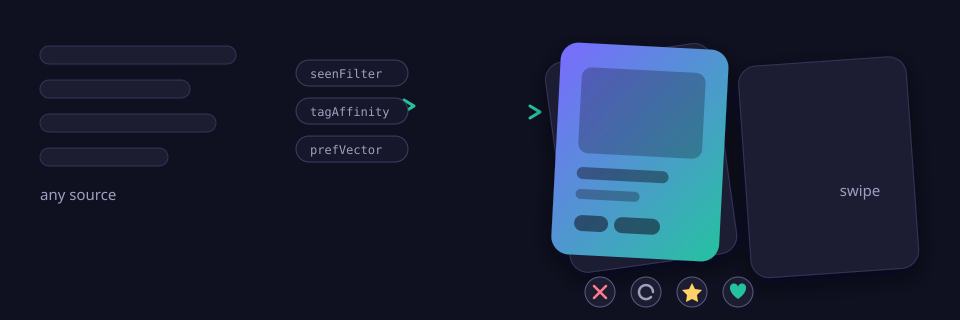
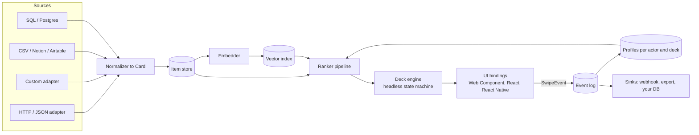

# Swipeline

**From any source to a ranked deck.** A swipe-first discovery toolkit for developers: connect a data source, get a ranked and swipeable deck, keep a portable history. Open source, modular, local-first.

[](https://github.com/JoeyHammoth/Swipeline/actions/workflows/ci.yml)
[](https://joeyhammoth.github.io/Swipeline/)
[](LICENSE)
[](https://www.typescriptlang.org/)
[](https://securityscorecards.dev/viewer/?uri=github.com/JoeyHammoth/Swipeline)

> **Status: pre-alpha (M0 foundation).** The repository is set up and the schemas are being reviewed. There is no publishable package yet — `@swipeline/core` is an unpublished workspace package and the quickstart below describes the v0.1 target, not something installable today. Follow the [roadmap](docs/roadmap.md) for milestone status.



<p align="center">
  
  &nbsp;<strong>TypeScript-first</strong> · Node.js 24+ · optional SQLite
</p>

## Why Swipeline?

<table>
  <tr>
    <td align="center" width="56"></td>
    <td><strong>Modular.</strong> Every layer — source, storage, ranking, UI — is a small package behind a typed interface. Use one, a few, or all of them.</td>
  </tr>
  <tr>
    <td align="center" width="56"></td>
    <td><strong>Local-first.</strong> The default setup keeps cards, events and profiles on the device. No Swipeline servers, no telemetry, export and erase built in.</td>
  </tr>
  <tr>
    <td align="center" width="56"></td>
    <td><strong>Any source.</strong> Declarative adapter mappings cover most JSON and REST APIs; write a typed adapter when you need more.</td>
  </tr>
  <tr>
    <td align="center" width="56"></td>
    <td><strong>Measurable ranking.</strong> A benchmark harness with synthetic users ships with the repo, so "the ranking works" is a number in CI, not a claim.</td>
  </tr>
</table>

Swipe UI libraries are plentiful but shallow — gestures and callbacks, no data, no ranking, no persistence. Recommender engines are powerful but swipe-agnostic and infrastructure-heavy. Swipeline is the glue: a normalized card schema, declarative source adapters, swipe-specific event semantics, ranking tuned for one-card-at-a-time decks, and a UI binding contract that any framework can satisfy.

## Choose your tier

| Tier | You install | You get | Backend |
|---|---|---|---|
| **1. Embed** | `@swipeline/core` + a UI binding + a store | A personalized swipe deck inside your app, with local history | None |
| **2. Serve** | Tier 1 + `@swipeline/server` | Multi-device sync, shared decks, webhooks, server-side ranking | Node/Bun/edge + SQLite or Postgres |
| **3. Integrate** | `@swipeline/core` (headless) + sinks | The engine and event stream inside your own UI and database | Yours |

## Quickstart (target for v0.1)

```bash
npm create swipeline@latest my-deck -- --template books
cd my-deck && npm install && npm run dev
```

Or add it to an existing React app:

```bash
npm install @swipeline/core @swipeline/react @swipeline/adapters @swipeline/store-indexeddb
```

```ts
// deck.config.ts
import { defineDeck } from '@swipeline/core'
import { httpJson } from '@swipeline/adapters'
import { indexedDbStore } from '@swipeline/store-indexeddb'

export const books = defineDeck({
  id: 'books',
  source: httpJson({
    id: 'openlibrary',
    url: 'https://openlibrary.org/search.json?q={query}&limit=50&page={page}',
    pagination: { type: 'page', param: 'page' },
    itemsPath: 'docs',
    map: { id: 'key', title: 'title', subtitle: 'author_name[0]', tags: 'subject[:8]' },
    attribution: { text: 'Data from Open Library', url: 'https://openlibrary.org' },
  }),
  store: indexedDbStore({ name: 'swipeline' }),
})
```

```tsx
// App.tsx
import { SwipeDeck } from '@swipeline/react'
import '@swipeline/react/styles.css'
import { books } from './deck.config'

export default function App() {
  return <SwipeDeck deck={books} query="science fiction" />
}
```

Until v0.1 lands, read [the design and implementation plan](docs/swipeline-design-and-implementation-plan.md) and the [architecture contracts](docs/architecture/contracts.md) that the packages will implement.

## Architecture



The append-only event log is the source of truth; profiles are derived and rebuildable. The headless engine is an observable store (`getSnapshot` / `subscribe` / `dispatch`), so bindings are thin and the engine never imports a UI framework — enforced in CI by `pnpm check:boundaries`.

## How it compares

| | Swipe UI library | Recommender engine (e.g. Gorse) | Swipeline |
|---|---|---|---|
| Gestures and card UI | Yes | No | Yes |
| Declarative source adapters | No | Model-and-item setup required | Yes |
| Swipe event semantics (undo, dwell, later) | No | No | Yes |
| Ranking with cold start and exploration | No | Yes, needs infrastructure | Yes, in-process and optional |
| Local-first default | Varies | No | Yes |
| Measurable quality in CI | No | Not by default | Yes |

Gorse and similar engines are a complement, not a competitor: an `external` rank stage can call one. See [the landscape notes](docs/landscape.md) for an honest comparison.

## Repository map

| Path | What lives there |
|---|---|
| `packages/core` | Card/event/profile schemas, config, deck engine (the only runtime dependency is a schema library) |
| `packages/` | 23 workspace packages: `core`, `rank`, `embed`, `vector`, `store-memory`, `store-indexeddb`, `store-sqlite`, `store-postgres`, `store-remote`, `gestures`, `element`, `react`, `binding-testkit`, `bench`, `sinks`, `server`, `cli`, `adapter-http-json`, `adapter-testkit`, `adapter-arxiv`, `adapter-openlibrary`, `adapter-themealdb`, `adapter-tmdb` |
| `docs/` | VitePress documentation site, ADRs, research notes and the design plan |
| `examples/` | Runnable demos that share one `deck.config.ts` across frameworks |
| `adapters/` | Compatibility pointer to first-party source adapters in `packages/adapter-*` |
| `registry/` | Community adapter index rendered by the docs site |
| `rfcs/` | Design proposals for schema and API changes |

## Contributing


Read [CONTRIBUTING.md](CONTRIBUTING.md) and the [Code of Conduct](CODE_OF_CONDUCT.md). We use the Developer Certificate of Origin — sign off your commits with `git commit -s`. Security reports go through [SECURITY.md](SECURITY.md), never a public issue. Governance, including how to become a maintainer, is in [GOVERNANCE.md](GOVERNANCE.md).

Looking for a first contribution? Browse [`good first issue`](https://github.com/JoeyHammoth/Swipeline/issues?q=is%3Aopen+label%3A%22good+first+issue%22), or start with a new source adapter, a card template, documentation fixes, or a binding for your favourite framework.

<br clear="right">

## Support

Questions and design discussions belong in [GitHub Discussions](https://github.com/JoeyHammoth/Swipeline/discussions). Reproducible bugs go to [GitHub Issues](https://github.com/JoeyHammoth/Swipeline/issues). Report security problems privately through [SECURITY.md](SECURITY.md).

## Credits

Feature icons and the contributor illustration are from [Icons8](https://icons8.com). File-level sources and licensing are recorded in [`docs/public/brand/ATTRIBUTION.md`](docs/public/brand/ATTRIBUTION.md).

## License

Apache-2.0. See [LICENSE](LICENSE) and [NOTICE](NOTICE). Documentation prose is licensed CC BY 4.0. The Apache license grants no trademark rights; see [TRADEMARKS.md](TRADEMARKS.md).

**Project vocabulary** is defined in [GLOSSARY.md](GLOSSARY.md). If a term here does not match the glossary, the glossary wins.
