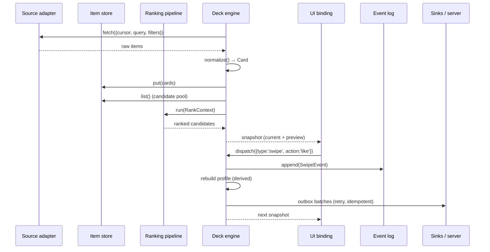

# Architecture overview

**Status:** M0. This document describes the shape the implementation targets. The
normative interfaces live in [contracts.md](contracts.md); decisions and their
reasoning live in [`docs/adr/`](../adr/).

## Layers

```
┌────────────────────────────────────────────────────────────────────┐
│ Bindings            element · react · react-native · vue · svelte  │  UI frameworks live only here
├────────────────────────────────────────────────────────────────────┤
│ Gestures            @swipeline/gestures (vanilla pointer/keyboard) │  DOM lives only here + bindings
├────────────────────────────────────────────────────────────────────┤
│ Engine              @swipeline/core: DeckStore, outbox, undo       │  framework-free, no DOM
├────────────────────────────────────────────────────────────────────┤
│ Ranking             @swipeline/rank: stages + pipeline             │  pure functions over RankContext
├────────────────────────────────────────────────────────────────────┤
│ Data                adapters · item store · event store · profile  │  every one behind an interface
│                     embedder · vector index · sinks                │
├────────────────────────────────────────────────────────────────────┤
│ Optional server     @swipeline/server (Hono) + SQLite/Postgres     │  same stores, server-side ranking
└────────────────────────────────────────────────────────────────────┘
```

A row depends only on the rows below it. `core` depends on nothing but its schema
library. `rank` depends on `core` types, not on stores. Bindings depend on
`core` + `gestures`. Nothing below the bindings row imports a UI framework, and
`pnpm check:boundaries` fails CI if that changes.

## Data flow



## Invariants

1. **The log is truth.** Anything derived (profile, counters, "seen" set) can be
   recomputed from events. Deleting derived state must never lose history.
2. **Ids are stable and namespaced.** A card id is `${sourceId}:${externalId}`;
   an event id is a ULID. Both survive refetching, relocation between devices and
   export/import.
3. **Append is idempotent.** Appending an event whose id is already present is a
   no-op that reports success, so retries are safe.
4. **Undo is a compensating event**, not a deletion. The log keeps the original
   action and the undo, and profile derivation applies both.
5. **No import-time work.** Constructing a store reads no globals; nothing
   touches `window` or `document` outside `gestures` and bindings. A server
   render must not throw.
6. **Snapshots are immutable and referentially stable.** Unchanged state returns
   the same reference, which is what makes `useSyncExternalStore` and equivalent
   glue correct.
7. **No silent network.** Tier 1 makes no request the developer did not
   configure; no telemetry, no phone-home, no remote config.
8. **Every swipe has a non-gesture path.** Buttons and keyboard exist in every
   binding; motion respects `prefers-reduced-motion`.

## Ranker pipeline semantics

- Stages run in order and may add, remove, reorder or annotate candidates. They
  never mutate the snapshot; they return a new `RankContext`.
- `seenFilter` must be first in any pipeline that has an event log, and it must
  be exhaustively correct: a card the actor has swiped must never reappear,
  including after undo + re-swipe.
- `mmr` must preserve the candidate set (reorder only) and must never emit a
  duplicate.
- `epsilonRandom` and `thompson` consume the injected `rng`; a seeded RNG must
  make the pipeline deterministic for tests and benchmarks.
- `limit` is a hard cap applied by the engine after the pipeline, not a hint.

## Storage matrix

| Concern | Interface | v0.1 default | Optional |
|---|---|---|---|
| Cards | `ItemStore` | `store-memory` | `store-indexeddb`, `store-sqlite`, `store-postgres` |
| Events | `EventStore` | `store-memory` | `store-indexeddb`, SQL, server |
| Profiles | `ProfileStore` | derived + memory | SQL, server |
| Vectors | `VectorIndex` | brute-force exact | `sqlite-vec`, `pgvector` |
| Embeddings | `Embedder` | none (hashed features) | Transformers.js, OpenAI-compatible, Ollama |
| Event delivery | `Sink` | console (dev only) | webhook (HMAC), JSONL, custom |

Server-side stores implement the same interfaces, which is what lets ranking run
in the client or on the server without a second implementation of the pipeline.

## Performance envelope (targets to verify in M1)

| Situation | Target |
|---|---|
| Candidate pool | 200–2,000 cards for client-side ranking |
| `seenFilter` + scoring over 2,000 candidates with 64-dim vectors | under 20 ms on a mid-range laptop |
| Snapshot update on swipe | under 4 ms of engine work, excluding animation |
| Prefetch buffer | 8 cards, refill when 3 remain (configurable) |
| Initial JS for `core` + `react` | budget set after the first measured build |

These are envelopes, not promises; the benchmark and CI budgets exist to keep
them honest.

## Failure modes

| Failure | Engine behaviour | Snapshot |
|---|---|---|
| Source fetch fails | Retry with backoff on idempotent requests; keep serving buffered cards | `error` with `lastError`, recoverable |
| Source returns malformed items | Adapter `normalize` drops them; a counter records the drop count | unchanged |
| Candidate pool exhausted | Stop fetching unless a cursor remains | `exhausted` |
| Event append fails | Keep the event in the outbox; the swipe still advances the deck | `offline` flag when the failure is connectivity |
| Embedder unavailable | Ranking degrades to hashed features, with a warning once | unchanged |
| Server 401/403 | Outbox pauses, surfaces `authError`; never drops events | `offline` + reason |

## SSR

- `getServerSnapshot()` returns a stable initial snapshot (no randomness, no
  clock-dependent values).
- Decks can be pre-ranked on the server and hydrated; the client must accept a
  pre-ranked buffer without refetching in the same session.
- Bindings render nothing interactive until hydration; declarative Shadow DOM
  is used where supported, with a render-after-hydration fallback.

## Repository boundaries

| Rule | Enforced by |
|---|---|
| No UI framework in non-binding packages | `pnpm check:boundaries` (script + ESLint rule) |
| No `window`/`document` outside `gestures` and bindings | ESLint `no-restricted-globals` per package |
| Only permissive dependency licenses | `pnpm licenses:check` |
| Public `exports` and types are valid | `pnpm publint` (publint + attw) |
| Schemas are the only definition of wire formats | `packages/core` tests + JSON Schema export |
