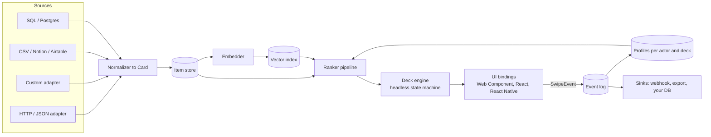

# Architecture

Swipeline is a stack of small packages. Each layer knows only about the layer
below it, which is what makes "use only the ranker" or "use only the deck engine"
possible.



## The four load-bearing ideas

### 1. The log is the source of truth

Swipe events are appended, never rewritten. Profiles, seen-sets and counters are
derived and can be rebuilt. Changing a ranking weight therefore never costs data,
and export is a dump rather than a migration.

### 2. The engine is an observable store

```ts
interface DeckStore {
  getSnapshot(): DeckSnapshot
  getServerSnapshot(): DeckSnapshot
  subscribe(listener: () => void): () => void
  dispatch(cmd: DeckCommand): void
}
```

That is the whole binding contract. React uses `useSyncExternalStore`, Vue a
`shallowRef`, Svelte a two-line adapter, a Web Component a re-render on subscribe.
Snapshots are immutable and return the same reference when nothing changed.

### 3. Gestures are framework-free

`@swipeline/gestures` is a vanilla pointer-events controller: drag tracking,
velocity, thresholds, CSS custom properties for transforms, keyboard and button
handling, reduced-motion behaviour. The decision math (`computeSwipeIntent`) is a
pure function shared with React Native, so web and mobile behave the same.

### 4. Boundaries are enforced, not documented

`pnpm check:boundaries` fails CI if a non-binding package depends on or imports
React, Vue, Svelte, Angular, Solid or Preact. `pnpm licenses:check` fails on
non-permissive production dependencies. The [`contracts`](/architecture/contracts)
page is the normative interface list; [ADRs](/adr/) record why the shapes are
what they are.

## Package responsibilities

| Layer | Package | Owns |
|---|---|---|
| Schemas & engine | `core` | Card/event/profile formats, deck state machine, outbox, undo |
| Ranking | `rank` | Stages, pipeline, default pipeline, trace reasons |
| Data | `adapters`, `store-*`, `embed`, `vector` | Fetching, caching, embeddings, nearest-neighbour |
| UI | `gestures`, `element`, `react`, `react-native`, `vue`, `svelte` | Input and rendering |
| Distribution | `sinks`, `server`, `cli`, `create-swipeline` | Delivery, sync, scaffolding |
| Quality | `bench`, `adapter-testkit`, `binding-testkit` | Proof that the other layers work |

## Where to change what

| You want to change | Change here | Not here |
|---|---|---|
| Where cards come from | A `SourceAdapter` | The engine |
| Card layout | A card template or render prop | `core` |
| Scoring | A `RankStage` | The binding |
| Storage | An `ItemStore` / `EventStore` / `ProfileStore` | Rank stages |
| Swipe semantics | `actions` config or the engine (with an RFC) | A binding |
| Visual theme | Design tokens | Package source |

## Invariants

1. Ids are stable: `${sourceId}:${externalId}` for cards, ULID for events.
2. Append is idempotent by event id.
3. Undo is a compensating event, never a deletion.
4. No import-time work; no `window`/`document` outside `gestures` and bindings.
5. Snapshots are immutable and referentially stable.
6. Tier 1 makes no network request the developer did not configure.
7. Every action has a button and a keyboard path; motion respects
   `prefers-reduced-motion`.

The full detail, including failure modes and performance envelopes, is in the
[architecture overview](/architecture/overview) and
[contracts](/architecture/contracts).
