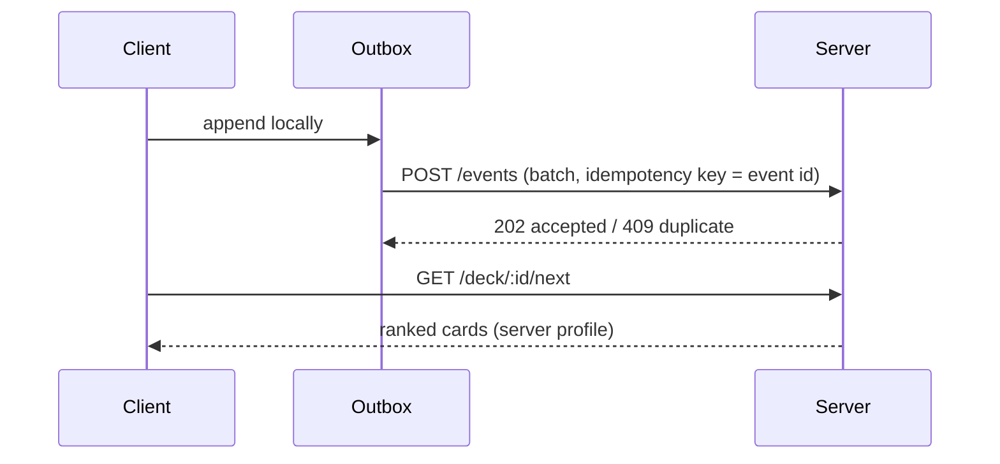

# Self-host the server

The optional server adds multi-device sync, server-side ranking and webhooks. It
is a small Hono app that implements the same store interfaces as the client, so a
deck behaves identically whether ranking runs in the browser or on the server.

::: warning Milestone M3
The server does not exist yet. This page describes the interface it will expose,
so client work can be planned against it.
:::

## Run it

```bash
npx swipeline serve --db ./swipeline.db --port 8787 --cors https://app.example.com
```

Or with Docker:

```bash
docker run -p 8787:8787 -v "$PWD/data:/data" -e SWILINE_HMAC_SECRET=… swipeline/server:0
```

SQLite is the default (one file, zero services). Postgres is supported by setting
`DATABASE_URL`, with `pgvector` optional for server-side vector search.

## API surface

| Method | Path | Purpose |
|---|---|---|
| `POST` | `/events` | Append a batch of events (idempotent by id) |
| `GET` | `/deck/:id/next?actor=…&limit=…` | Ranked cards for an actor |
| `GET` | `/collections/:id` | Saved `later` items |
| `GET` | `/export/:actor` | JSONL of events |
| `DELETE` | `/actors/:actor` | Erase all events for an actor |
| `GET` | `/health` | Liveness |
| `GET` | `/openapi.json` | Generated from the same schemas |

The OpenAPI document is generated from the shared schemas, which is how Flutter,
Swift and Kotlin clients can be produced without a JS engine.

## Authentication

Swipeline does not implement user accounts. Two hooks are provided:

```ts
createServer({
  authenticate: async (request) => {
    const token = request.headers.get('authorization')?.replace('Bearer ', '')
    const claims = await verifyJwt(token)
    return claims ? { actor: claims.sub } : null
  },
})
```

- **API key** for machine-to-machine use.
- **JWT verification hook** for apps that already have auth.
- Return `null` to reject with 401. Never trust an `actor` from the request body.

## Sync model



Events are append-only, so last-write-wins is not needed: duplicates are dropped
by id, and ordering is by ULID. A client that has been offline flushes its outbox
in order.

## Webhooks

`POST` batches are signed:

```
X-Swipeline-Signature: t=1732449600,v1=<hmac-sha256(t + "." + body, secret)>
```

Receivers should reject timestamps older than five minutes and deduplicate by
event id. The CLI has a `swipeline webhook listen` helper (M3) that prints verified
payloads locally.

## Operations

| Concern | Guidance |
|---|---|
| Backups | SQLite file, or your Postgres backup policy |
| Migrations | Apply on boot by default; disable with `MIGRATIONS=manual` in production |
| Rate limits | Put the server behind a proxy; it does not rate-limit by actor |
| Logs | Structured JSON; event bodies are not logged by default |
| Deletion | `DELETE /actors/:actor` is synchronous and irreversible |
| TLS | Terminate at the proxy; the server speaks plain HTTP |

## Privacy

Running the server means events leave the device. Before you do:

1. Update your privacy notice and consent flow.
2. Decide retention and implement it.
3. Keep the HMAC secret and database credentials out of the client.
4. Read [Local-first and privacy](/concepts/local-first-and-privacy) — the
   sensitive-category guidance applies to what you store server-side.
