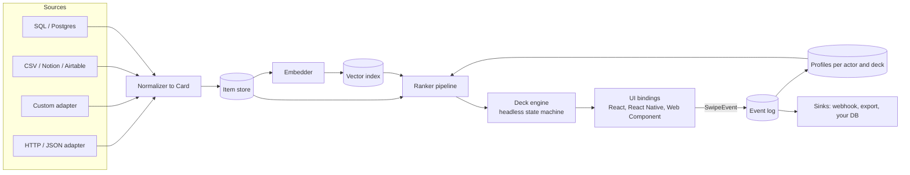

# Swipeline: Design & Implementation Plan

> **Swipe-first discovery toolkit.** Connect any data source, get a ranked and swipeable deck, keep a portable history. Open source, modular, local-first.

| | |
|---|---|
| **Status** | Draft v0.3 (M0 resolutions: research verification, ADRs, architecture contracts and resolved open questions — see [decisions](decisions/open-questions.md)) |
| **Date** | 2026-11-24 |
| **Working name** | Swipeline (see [section 17](#17-naming) for alternatives and the name-check checklist) |
| **Proposed license** | Apache-2.0 (see [section 10](#10-open-source-project-setup)) |
| **Primary language** | TypeScript (ESM-first) |
| **Docs** | VitePress, deployed to GitHub Pages via GitHub Actions |

## Table of contents

0. [TL;DR](#0-tldr)
1. [The gap: what exists and what is missing](#1-the-gap-what-exists-and-what-is-missing)
2. [Vision, goals and non-goals](#2-vision-goals-and-non-goals)
3. [Form factor: what should it be?](#3-form-factor-what-should-it-be)
4. [Language and tech stack](#4-language-and-tech-stack)
5. [Architecture](#5-architecture)
   - [5.8.1 Making it framework-agnostic](#581-making-it-framework-agnostic)
6. [Package layout](#6-package-layout)
7. [Using it in a project](#7-using-it-in-a-project)
8. [Configurability, modularity and extension points](#8-configurability-modularity-and-extension-points)
9. [Sharing: decks, adapters, history](#9-sharing-decks-adapters-history)
10. [Open source project setup](#10-open-source-project-setup)
    - [10.6 Repository security settings checklist](#106-repository-security-settings-checklist)
11. [CI/CD with GitHub Actions](#11-cicd-with-github-actions)
12. [Documentation site on GitHub Pages](#12-documentation-site-on-github-pages)
13. [Testing and evaluation strategy](#13-testing-and-evaluation-strategy)
14. [What it looks like](#14-what-it-looks-like)
15. [Roadmap and milestones](#15-roadmap-and-milestones)
16. [Risks and mitigations](#16-risks-and-mitigations)
17. [Naming](#17-naming)
18. [Open questions and decisions needed](#18-open-questions-and-decisions-needed)
19. [References](#19-references)

---

## 0. TL;DR

**What it is.** A TypeScript monorepo of small, composable packages that give a developer everything behind a Tinder-style swipe interface: a card UI, source adapters that turn any API or database into cards, an append-only swipe-event log, user/profile storage, and a pluggable ranking pipeline (embeddings, bandit-style exploration, diversity). A CLI scaffolds and runs it, and an optional self-hostable server provides multi-device sync and webhooks.

**Form factor.** Library-first toolkit, not a framework and not a SaaS. Three adoption tiers:

1. **Embed**: `core` + a UI binding, fully client-side and local-first. No backend.
2. **Serve**: add the self-hostable server for shared storage and multi-device sync.
3. **Integrate**: use the headless engine and event sinks inside your own app and database.

**Why it is worth building.** Swipe UI components are plentiful but shallow (gestures and callbacks only). Recommender engines exist but are swipe-agnostic and infrastructure-heavy. Many one-off swipe apps keep re-implementing the same stack by hand. The glue between them is missing: declarative source adapters, a normalized card schema, swipe-specific event semantics, cold-start and exploration logic tuned for one-card-at-a-time decks, and a benchmark to prove the ranking works.

**Decisions proposed in this doc.**

| Topic | Decision |
|---|---|
| Language | TypeScript, ESM-first, strict mode |
| Repo layout | pnpm workspaces monorepo |
| License | Apache-2.0, with DCO sign-off instead of a CLA |
| CI/CD | Yes, GitHub Actions: CI, release (Changesets + npm trusted publishing), docs deploy, security scans |
| Docs | VitePress on GitHub Pages, with an interactive playground |
| Framework support | Framework-neutral engine with an observable store contract, a vanilla gesture module, a Web Component reference binding, first-party React, React Native, Vue and Svelte bindings, and a conformance suite (section 5.8.1) |
| Repository security | Dependabot alerts, security updates and version updates; CodeQL; secret scanning with push protection; rulesets; restricted Actions permissions (checklist in section 10.6) |
| Default storage | In-memory plus IndexedDB (web); SQLite and Postgres for server |
| Default ranking | Preference vector over embeddings (with a no-ML fallback), Thompson-sampling exploration, MMR diversity |
| First milestone | v0.1: core with the observable `DeckStore`, vanilla gesture module, React deck, JSON/HTTP adapter, memory + IndexedDB stores, baseline ranker, docs, two demos |

---

## 1. The gap: what exists and what is missing

This section summarizes a landscape check done in November 2026. It is evidence for the claim that an integrated tool is missing, not a proof. See the pre-launch check at the end of this section.

### 1.1 Layer-by-layer landscape

| Layer | What exists | What is missing |
|---|---|---|
| **Swipe UI components** | Many libraries per framework: React Native (`react-native-deck-swiper`, `react-native-card-stack-swiper`, `react-native-swipeable-card-stack`, `rn-swiper-list`, `react-native-cards-swipe`), React (`react-swiped`, `react-card-swiper`), Svelte (`svelte-swiper-cards`), vanilla JS (`card-flick`), Flutter (`flutter_swipe_deck`, `flutter_card_swiper`) | Gestures and callbacks only. No persistence, no ranking, no data sources. Fragmented across frameworks. Some are aging: a package-health tracker flagged `react-native-deck-swiper` for roughly a year without a release and a single maintainer |
| **Recommender engines** | Gorse (open source, Go, REST API, dashboard, multimodal via embeddings); hosted services such as Recombee, Amazon Personalize, Algolia Recommend; ML libraries such as LightFM, implicit, LensKit | Swipe-agnostic. You model users, items and feedback yourself, and you run infrastructure (Gorse alone uses a relational/NoSQL database plus Redis, with master, worker and server nodes). Heavy for "I need a 50-card deck" |
| **Product layer** | Single-domain swipe apps (movies, books, fashion, music, news, repos, rentals, product launches). Multi-category apps exist but with developer-curated categories | Not reusable. Users cannot bring their own source |
| **Open-source demos** | Hackathon-style repos such as Homi (rentals), BranchOut (GitHub repos), Watchify (movies), Flippr (books), Newsly (news), SwipeX (news) | Each re-implements swipe endpoint + database + ranking from scratch |

### 1.2 The specific gap

No project found combines all of the following in one coherent, documented, open-source toolkit:

1. Declarative **source adapters** that map arbitrary APIs and databases to a normalized card.
2. A **swipe event model** with swipe-specific semantics (like, dislike, super-like, later, undo, dwell time).
3. **Pluggable ranking** designed for one-card-at-a-time decks, including cold start and exploration.
4. **UI bindings** across web and mobile on top of one headless engine.
5. **Storage that is local-first** by default, with an optional server.
6. An **offline benchmark** so ranking quality can be measured instead of asserted.

### 1.3 Pre-launch landscape check (do before announcing)

Absence of evidence is not evidence of absence. Before the public launch, repeat the search on GitHub, npm, PyPI, pub.dev, Product Hunt and Hacker News using the queries "swipe deck SDK", "swipe recommendations library", "tinder-style feed backend", "card swipe + recommender". Record the results in `docs/landscape.md` and be honest in the README about overlap (for example, Gorse is a complement, not a competitor).

---

## 2. Vision, goals and non-goals

### 2.1 Vision

Any list of things a person might be interested in (papers, apartments, recipes, phones, restaurants, projects, songs) can become a fast, personalized, swipeable deck in minutes, and the person's choices stay theirs, portable and exportable.

### 2.2 Goals

| ID | Goal | How we will know |
|---|---|---|
| G1 | **Time-to-first-deck under 10 minutes** | A CI job scaffolds the starter template from scratch and builds it; the quickstart is tested end to end |
| G2 | **Modular**: every layer replaceable | Each layer is a separate package behind a small TypeScript interface; a test swaps each default implementation for a stub |
| G3 | **Local-first and privacy-respecting by default** | The Tier 1 setup makes zero network calls to Swipeline-owned services (there are none). History can be exported and erased |
| G4 | **Domain-agnostic** | Examples in at least four unrelated domains share the same core and card schema |
| G5 | **Honest ranking** | A benchmark harness with synthetic users reports hit-rate versus a random baseline in CI |
| G6 | **Accessible** | Keyboard, button and screen-reader paths exist for every swipe action; respects reduced-motion |
| G7 | **Easy to contribute** | A new adapter is one small package with a template, a test kit, and a documented review checklist |
| G8 | **Framework-agnostic** | The engine has no UI-framework dependency (CI-enforced); Web Component, React and at least one non-React binding pass the same conformance suite |
| G9 | **Secure by default** | Repository security checklist (section 10.6) is complete before the first publish; releases use trusted publishing with provenance |

### 2.3 Non-goals

- **Not a dating or social matching product.** No two-sided matching in core (a plugin could add it later).
- **Not a hosted SaaS** in the first versions. A hosted offering, if ever, would be a separate project built on the open-source core.
- **Not a general recommender engine.** We do not try to replace Gorse, Recombee or similar. We integrate with them through a ranker plug-in.
- **Not a scraping tool.** Adapters target documented APIs, exports and user-owned data.
- **Not an ad or tracking platform.** The developer-facing event stream exists to power the developer's own product, with user consent controls (section 5.9).

---

## 3. Form factor: what should it be?

### 3.1 Options considered

| Option | Pros | Cons | Verdict |
|---|---|---|---|
| **Single UI component library** | Easy to build and understand | This is the crowded, shallow layer; adds nothing new | Rejected as the whole product; kept as one package |
| **Full-stack framework** (opinionated app + backend) | Fast demos | Forces stack choices; hard to adopt piecemeal; large maintenance surface | Rejected |
| **Hosted SaaS / API** | Easy onboarding; recurring revenue | Not open source in spirit; privacy concerns; operational burden | Rejected for v1 |
| **CLI only** | Good for scaffolding | Not where the runtime logic lives | Kept as one package (scaffolding and dev tools) |
| **Python library** | Strong ML ecosystem | No UI story; poor fit for web and mobile | Rejected as primary; a Python client for the server and event format is a later community option |
| **Monorepo toolkit: headless core + bindings + optional server + CLI** | Modular; adoptable in layers; fits web, mobile and server; one language | More packages to maintain; needs strong docs | **Chosen** |

### 3.2 Chosen form

> **A library-first toolkit delivered as a monorepo of small packages, with a CLI for scaffolding and development, and an optional self-hostable server.**

Principles:

1. **Headless core.** All logic (deck state machine, event handling, ranking) lives in framework-free packages. UI bindings are thin.
2. **Layers adoptable alone.** You can use only the ranker, only the event log, only the UI, or everything.
3. **Declarative first, code when needed.** Common cases are configuration; anything else is a typed plug-in.
4. **No required backend.** The default runs entirely in the browser or app.

### 3.3 Adoption tiers

| Tier | You install | You get | Backend needed |
|---|---|---|---|
| **1. Embed** | `@swipeline/core`, `@swipeline/react` (or React Native), a store | A personalized swipe deck in your app with local history | None |
| **2. Serve** | Tier 1 + `@swipeline/server` | Multi-device sync, shared decks, webhooks, server-side ranking | Node/Bun/edge runtime + SQLite or Postgres |
| **3. Integrate** | `@swipeline/core` (headless) + sinks | Engine and events inside your own UI and database | Yours |

---

## 4. Language and tech stack

### 4.1 Language: TypeScript

| Reason | Detail |
|---|---|
| One language everywhere | Browser, React Native, Node/Bun/edge server and CLI all run TypeScript, so the engine is written once |
| Types are the contract | Adapter, store, embedder, ranker and sink interfaces are TypeScript types. Plug-in authors get autocomplete and compile-time checks |
| Schemas for other languages | Core types are defined with a schema library (e.g. Zod) and exported as JSON Schema, so Python, Go or Dart clients can validate the same card and event formats |
| Contributor reach | The largest pool of potential contributors for UI and tooling work |

**Rejected or deferred:** a Rust/WASM core (possible later optimization for vector math if profiling justifies it); Python (no UI story); Dart/Flutter (a community port could consume the JSON Schema and event format).

### 4.2 Tooling

| Concern | Choice | Notes |
|---|---|---|
| Package manager | pnpm workspaces | Fast, strict, good monorepo support. Set the `packageManager` field so CI picks the right version |
| Build | tsup or tsdown (ESM + CJS + `.d.ts`) | Small, fast; per-package builds |
| Task runner | Turborepo (optional) | Add only if build times justify it |
| Test | Vitest | Unit, property-based (fast-check) and component tests |
| Lint/format | ESLint (flat config) + Prettier, or Biome | Pick one and enforce in CI |
| Types | `strict: true`, `exactOptionalPropertyTypes` | Public API surface checked with `api-extractor` or `publint` + `arethetypeswrong` |
| Versioning | Changesets | One changeset per user-facing PR; independent package versions |
| Docs | VitePress + TypeDoc | Static site on GitHub Pages |
| E2E | Playwright (web demos); Maestro or Detox later (React Native) | Start with web only |
| Node versions | Current LTS lines | Test on the two active/maintenance LTS releases |

### 4.3 Key dependency policy

- Core has **zero runtime dependencies** except a schema library. Everything else is an optional package.
- Only **permissive** licenses (MIT, Apache-2.0, BSD, ISC) in published packages. Block GPL/AGPL/SSPL/BUSL and source-available "commercial for production" licenses in CI. Example: some SQLite vector extensions are free for evaluation but require a commercial license for production use, so they must not be a default or bundled dependency.
- Prefer **peer dependencies** for UI libraries (React, Reanimated, Gesture Handler) to avoid duplicate installs.

---

## 5. Architecture

### 5.1 Overview



**Event sourcing.** The append-only **event log is the source of truth**. Profiles (preference vectors, tag statistics, counters) are *derived* and can be rebuilt from the log. Consequences: changing the ranker config never loses data, history is trivially exportable, and the benchmark can replay logs.

### 5.2 Core data model

```ts
// Normalized item shown on a card
export interface Card {
  schemaVersion: 1
  id: string                 // `${sourceId}:${externalId}`, stable across fetches
  sourceId: string
  title: string
  subtitle?: string
  body?: string              // abstract, description, review snippet
  media?: Array<{ kind: 'image' | 'video'; url: string; alt?: string; width?: number; height?: number }>
  tags?: string[]            // categories, genres, keywords
  facts?: Array<{ label: string; value: string | number; unit?: string }>   // price, rating, specs
  url?: string               // canonical link-out
  attribution?: { text: string; url?: string; required?: boolean }
  extra?: Record<string, unknown>          // raw fields adapters want to keep
  embedding?: number[] | Float32Array      // optional, filled by an Embedder
  fetchedAt: string          // ISO 8601
}

export type SwipeAction = 'like' | 'dislike' | 'superlike' | 'skip' | 'later' | 'undo' | (string & {})

export interface SwipeEvent {
  schemaVersion: 1
  id: string                 // ULID: sortable, unique
  deckId: string
  cardId: string
  actor: string              // pseudonymous user id; never required to be real PII
  action: SwipeAction
  position: number           // index in the session's deck
  dwellMs?: number           // time the card was visible before the action
  ts: string                 // ISO 8601
  context?: Record<string, unknown>   // e.g. { query, filters, rankerVersion }
}

export interface Profile {
  actor: string
  deckId: string
  prefVector?: number[]                          // derived
  tagStats: Record<string, { a: number; b: number }>   // Beta posteriors for exploration
  counts: { seen: number; liked: number; disliked: number }
  updatedAt: string
}
```

Design notes:

- **Stable IDs** are namespaced by source, so one history can span many sources.
- **`facts`** lets a product deck (phones, houses) show a compact spec strip without per-domain code.
- **`attribution`** is part of the schema because many APIs require crediting and limit caching; adapters declare it and UIs render it.
- **`extra`** keeps source-specific data without polluting the schema.
- All schemas are versioned (`schemaVersion`) with migrations, and exported as JSON Schema.

### 5.3 Source adapters

```ts
export interface SourceAdapter<TRaw = unknown> {
  id: string
  capabilities: {
    pagination: 'cursor' | 'offset' | 'none'
    search?: boolean          // supports a text query
    filters?: string[]        // names of supported filters
  }
  attribution?: Card['attribution']
  fetch(ctx: { cursor?: string; query?: string; filters?: Record<string, unknown>; signal?: AbortSignal }):
    Promise<{ items: TRaw[]; nextCursor?: string }>
  normalize(raw: TRaw): Card | null          // null drops the item
}
```

Three ways to define a source, from least to most code:

1. **Declarative mapping** (covers most REST/JSON APIs): URL template, pagination style, and a field map from JSON paths to card fields. Serializable, so it can live in a shareable manifest (section 9).
2. **Adapter package**: a published `swipeline-adapter-<name>` with typed options (e.g. arXiv, TMDB-like movie databases, Open Library, recipe APIs, Open Food Facts, Wikipedia/Wikidata).
3. **Custom function**: implement `SourceAdapter` directly for databases, GraphQL, files, internal APIs.

Built-in generic adapters planned: `http-json`, `csv`, `sql` (Postgres/SQLite via a user-supplied client), `notion` and `airtable` (later, behind optional packages).

Adapter responsibilities: pagination, rate-limit friendliness (backoff, `Retry-After`), caching hints, attribution, and **never** bypassing a provider's terms. A test kit (`@swipeline/adapter-testkit`) validates an adapter against recorded fixtures and the card schema.

### 5.4 Item store, embeddings and vector index

| Interface | Purpose | Default | Optional |
|---|---|---|---|
| `ItemStore` | Cache normalized cards | In-memory | IndexedDB, SQLite, Postgres |
| `Embedder` | Turn a card into a vector | **None** (text/tag features, no ML) | Transformers.js (in-browser/Node), any OpenAI-compatible HTTP endpoint, Ollama |
| `VectorIndex` | Nearest-neighbour lookup | **Brute-force exact cosine** over typed arrays | `sqlite-vec` (pre-v1 at time of writing), `pgvector`, PGlite + pgvector |

Why brute-force by default: a per-user candidate pool is typically hundreds to a few thousand cards, where exact search over typed arrays is fast and has no native dependencies. This also avoids depending on pre-v1 extensions for the default path. Indexes are optional accelerators behind the same interface.

Embedding text is built from a configurable template (for example `{title}. {subtitle}. {tags}. {body}`), and images can be embedded by providers that support them.

### 5.5 Event log, profiles and sinks

- `EventStore`: append events, query by actor/deck/time, export JSONL, erase by actor.
- `ProfileStore`: derived state, rebuilt on demand via `rebuildProfile(actor, deck)`.
- **Outbox pattern**: the client records events locally first, then syncs (to the server or a sink) with retry and idempotency keys (event `id`), so swiping works offline.
- **Sinks** receive batches of events: `webhook` (HMAC-signed), `jsonl-file`, `console`, or a custom function. This is how developers feed swipe data into their own analytics or recommenders.

Default **action weights** (all configurable, to be tuned with the benchmark, section 13):

| Action | Default weight | Rationale |
|---|---|---|
| `superlike` | +2.0 | Strong positive intent |
| `like` | +1.0 | Positive |
| `later` | +0.5 | Soft interest; also saved to a collection |
| `skip` | -0.1 | Weak negative; may just mean "not now" |
| `dislike` | -0.6 | Negative, discounted because fast dismissals are noisy |
| `undo` | reverses the last event's contribution | Keeps the profile honest |

Optional implicit signal: dwell time can scale weights (longer dwell before a like increases confidence) behind a flag, off by default.

### 5.6 Ranking pipeline

Ranking is a **pipeline of stages**, each a small typed function. Users compose stages in config.

```ts
export interface RankContext {
  actor: string
  deckId: string
  candidates: Array<{ card: Card; score: number; reasons?: string[] }>
  profile: Profile
  limit: number
  rng: () => number            // seedable for reproducible tests and benchmarks
  [k: string]: unknown
}
export interface RankStage {
  name: string
  run(ctx: RankContext): Promise<RankContext> | RankContext
}
```

Built-in stages (v1 target set):

| Stage | What it does |
|---|---|
| `seenFilter` | Removes already-swiped cards (from the event log) |
| `hardFilters` | Applies user filters (price range, tags to exclude) |
| `popularityRecency` | Baseline score for cold start (source-provided popularity, freshness) |
| `tagAffinity` | Scores by tag statistics (Beta posteriors per tag) |
| `prefVector` | Preference-vector scoring over embeddings (Rocchio-style: mean of liked vectors minus a discounted mean of disliked vectors, with time decay), cosine similarity to candidates |
| `thompson` | Exploration: samples from tag/cluster posteriors so uncertain-but-promising areas surface sometimes |
| `epsilonRandom` | A small fraction of purely random cards, preventing filter bubbles and giving the benchmark unbiased data |
| `mmr` | Maximal Marginal Relevance diversification so consecutive cards are not near-duplicates |
| `explain` | Attaches short reasons ("similar to 3 things you liked") for UI and debugging |
| `external` | Calls an external ranker (e.g., a Gorse instance or a custom HTTP service) and merges |

Default pipeline: `seenFilter → hardFilters → popularityRecency → tagAffinity → prefVector → thompson → epsilonRandom → mmr`.

**Cold start** (a new actor with no history):

1. Optional **onboarding**: pick tags or "pick 3 favourites" from a seed deck; this writes synthetic high-weight events marked `context.seed = true`.
2. Otherwise rank by `popularityRecency` plus higher exploration; as events arrive, `prefVector` and `tagAffinity` take over (blend weight grows with the number of events).

**Why it works without embeddings:** with no `Embedder`, the preference vector is built from hashed tag/text features (bag-of-words/TF-IDF), so a deck is personalized from the first dozen swipes with zero ML dependencies. Embeddings are an upgrade, not a requirement.

**Optional LLM stage (later, off by default):** an `llmRerank` or `explain` stage that calls a user-supplied model to re-rank the top K or to write the "why this card" line. Always optional, always user-supplied credentials, never in the default path.

### 5.7 Deck engine (headless)

A small state machine that UI bindings subscribe to.

States: `idle → loading → ready → (dragging ↔ ready) → committing → ready | exhausted | error | offline`.

Responsibilities:

- Maintain a **prefetch buffer** (default 8 cards, refill when 3 remain) so the next card is always ready.
- Apply **gesture-to-action mapping** (`right: like`, `left: dislike`, `up: superlike`, `down: later` by default; fully configurable).
- Keep an **undo stack** (default depth 5).
- Emit typed events (`card:shown`, `swipe`, `undo`, `exhausted`, `error`) and write to the event log through the outbox.
- Handle exhaustion (empty deck, "come back later"), errors and offline states explicitly, with hooks for UI.

Because the engine is headless, the same logic powers React, React Native, a Web Component and any community binding.

### 5.8 UI bindings

| Package | Target | Notes |
|---|---|---|
| `@swipeline/gestures` | Any web framework | Framework-free pointer, keyboard and reduced-motion controller shared by all web bindings |
| `@swipeline/element` | Any framework | `<swipe-deck>` Web Component; the reference binding, built early (M2) |
| `@swipeline/react` | React (web) | Thin wrapper over the engine and `gestures`; no animation library required; optional motion integration |
| `@swipeline/react-native` | React Native / Expo | Drags use `PanResponder` from React Native core, so no Gesture Handler or Reanimated install is required; shares the swipe-intent math |
| `@swipeline/vue`, `@swipeline/svelte` | Vue, Svelte | Thin first-party bindings (M4), conformance-tested |
| Community | Solid, Angular, Flutter and native (via OpenAPI + server) | "Write a binding" guide and the conformance suite |

Accessibility requirements (non-negotiable, tested in CI):

- Every swipe action has a **button** and a **keyboard shortcut** (arrow keys by default).
- Cards are announced via an ARIA live region; focus management on advance.
- Honors `prefers-reduced-motion`.
- Sufficient contrast in default theme; theme tokens documented.

### 5.8.1 Making it framework-agnostic

**Where the plan stood.** The engine, ranking, storage, adapters, sinks, server and CLI have no UI-framework dependency. The gap was the UI layer: the first bindings were React-first, and the only framework-neutral option (the Web Component) came late. This section closes that gap with explicit design rules, a binding contract, and a definition of done.

**What "framework-agnostic" means here.** Any UI framework can drive a Swipeline deck with a thin binding, and the same `deck.config.ts` works unchanged everywhere. It does not mean one UI package that works identically in every framework: each framework still needs a small binding for idiomatic rendering. Native non-JS platforms (Flutter, Swift, Kotlin) use the server API instead of the JS engine.

#### Rule 1: The engine is an observable store

The headless engine exposes one small, framework-neutral contract. Every binding is a few lines of glue over it.

```ts
export interface DeckStore {
  getSnapshot(): DeckSnapshot           // immutable; the same reference if nothing changed
  getServerSnapshot(): DeckSnapshot     // stable initial snapshot for SSR and hydration
  subscribe(listener: () => void): () => void
  dispatch(cmd: DeckCommand): void      // 'swipe' | 'undo' | 'refill' | 'setQuery' | ...
}
```

| Framework | Glue over `DeckStore` |
|---|---|
| React | `useSyncExternalStore(store.subscribe, store.getSnapshot, store.getServerSnapshot)` |
| Vue | A `shallowRef` updated from `subscribe`, cleaned up with `onScopeDispose` |
| Svelte | A tiny `toSvelteStore(store)` helper (Svelte's store contract calls the subscriber immediately with the current value) |
| Solid | `from(...)` or a signal fed by `subscribe` |
| Angular | A `signal` fed by `subscribe`, cleaned up with `DestroyRef` |
| Web Component | Re-render on `subscribe`; expose snapshot as properties and actions as events |
| Anything else | `subscribe` + `getSnapshot` is all that is required |

Snapshots are immutable and referentially stable when nothing changed, which is what makes the glue correct and cheap in every framework.

#### Rule 2: Gestures live in a framework-free module

`@swipeline/gestures` is a vanilla pointer-events controller: drag tracking, velocity and threshold logic, CSS-transform output through custom properties, keyboard and button handling, and reduced-motion behavior. It emits `drag`, `commit` and `cancel` to the engine. A framework binding only renders DOM and attaches the controller (through a ref, action or directive).

React Native cannot use the DOM, so it has its own gesture layer, but the decision math (distance, velocity, direction to action) is exported as pure functions (`computeSwipeIntent`) and shared, so behavior stays consistent across web and mobile.

#### Rule 3: A rendering contract that avoids framework lock-in

- Bindings render from the snapshot; card content is customized with each framework's idiom (slots, render props, snippets, templates).
- Default styles are plain CSS with design tokens: no CSS-in-JS runtime and no Tailwind requirement.
- No binding adds behavior the engine cannot express. If two bindings need the same logic, it moves into the engine or `gestures`.

#### Rule 4: The Web Component is the reference binding, built early

`@swipeline/element` provides `<swipe-deck>` (properties in, DOM events out, slots for card templates, CSS custom properties and parts for styling). It is built right after the first React binding (milestone M2, not M4) because:

- It gives every framework a working day-one option.
- It proves the binding contract before more bindings depend on it.
- Frameworks can wrap it where they want native-feeling props and events.

Known friction to design for: Shadow DOM styling (solved with parts and tokens), server rendering (render after hydration, or use declarative Shadow DOM where supported), and varying custom-element ergonomics across framework versions (the conformance suite covers each).

#### Rule 5: No framework imports outside binding packages (CI-enforced)

- `core`, `rank`, `embed`, `vector`, `adapters`, `stores`, `sinks`, `server`, `cli` and `gestures` must not import or depend on React, Vue, Svelte or similar, even as peer dependencies.
- Enforced by `pnpm check:boundaries` in CI (for example, a dependency-boundary lint rule plus a script that fails if a framework appears in `dependencies` or `peerDependencies` of a non-binding package).

#### Rule 6: SSR and hydration safe

- No work at import time; no `window` or `document` access outside `gestures` and the bindings.
- `getServerSnapshot` returns a stable initial snapshot, and decks can be pre-ranked on the server and hydrated on the client.
- Smoke apps for Next.js and Nuxt or SvelteKit run in CI.

#### Rule 7: A conformance suite every binding must pass

`@swipeline/binding-testkit` defines the behavior contract, run with Playwright against a fixture page that each binding implements. A binding is listed as "official" or "compatible" in the docs only if it passes.

| Behavior checked | Details |
|---|---|
| Renders from snapshot | Current card and next-card preview match engine state |
| Pointer swipe | Drag past threshold commits the mapped action; short drag cancels |
| Keyboard and buttons | Every action reachable without a gesture; documented shortcuts work |
| Undo | Restores the previous card and reverses the event |
| Accessibility | ARIA live announcements, focus management on advance, reduced-motion path |
| States | Loading, exhausted, error and offline states render and recover |
| Custom card | Slot, template or render-prop output replaces the default card |
| Lifecycle | Unmount unsubscribes (no leaks); remount restores state |
| SSR | Server render does not throw; hydration matches |

#### Rule 8: Non-JS platforms through the server contract

- The server publishes an **OpenAPI specification** generated from the same schemas as the JSON Schema export, so Flutter, Swift and Kotlin clients can be generated.
- Ranking runs server-side for these clients, so results match the JS clients.
- `Card` and `SwipeEvent` are the stable interop surface (versioned, with migrations).

#### Rule 9: Proof through examples

`examples/` contains one app per supported framework (React, Vue, Svelte, plain HTML with the Web Component, and React Native/Expo), all using the **identical** `deck.config.ts`. If a config change is ever needed per framework, the abstraction has leaked and is treated as a bug.

#### Binding status matrix (published in the docs)

| Binding | Maintainer | Target milestone | Conformance |
|---|---|---|---|
| `@swipeline/element` (Web Component) | First-party | M2 | Full (reference) |
| `@swipeline/react` | First-party | M1 | Full |
| `@swipeline/react-native` | First-party | M4 | Native-adapted subset |
| `@swipeline/vue` | First-party (thin) | M4 | Full |
| `@swipeline/svelte` | First-party (thin) | M4 | Full |
| Solid, Angular, others | Community | Post-1.0 | Via the "Write a binding" guide and testkit |
| Flutter, Swift, Kotlin | Community | Post-1.0 | Via OpenAPI-generated clients (no JS engine) |

#### Definition of done for "framework-agnostic"

- [ ] No framework imports outside binding packages, enforced in CI
- [ ] Web Component, React and one of Vue or Svelte pass the full conformance suite by v0.5
- [ ] The same `deck.config.ts` runs unmodified in every example app
- [ ] SSR smoke tests pass (Next.js and Nuxt or SvelteKit)
- [ ] "Write a binding" guide and the status matrix are published in the docs
- [ ] OpenAPI specification is published with the server, and at least one generated non-JS client is smoke-tested

**Honest limits:** React Native shares the engine and the decision math but not the DOM gesture module. Flutter and native platforms have no JS engine, so they rely on the server or a community port. "Full" agnosticism here means a framework-neutral engine and contract with thin, testable bindings, not zero per-framework code.

### 5.9 Privacy, consent and data ownership

- **Local-first default**: events and profiles stay on-device in Tier 1.
- **Pseudonymous actor IDs**: Swipeline never requires real identity.
- **Scoped sharing** in Tier 2/3: sinks and the server only receive events for decks and actions the app has explicitly enabled; a `ConsentPolicy` hook lets apps gate event emission per user.
- **Export and erase** are first-class APIs: `exportActor()` (JSONL) and `eraseActor()`.
- **No telemetry** in the packages themselves. Any analytics belong to the host app.
- **Webhook signing** (HMAC) and replay protection (timestamp + event ID) for the server.
- Docs include a "privacy by design" guide covering consent, retention and the risks of sharing swipe history (e.g., sensitive categories such as housing or health).

### 5.10 Server (optional)

`@swipeline/server`: a small, portable HTTP service (a runtime-agnostic framework such as Hono works on Node, Bun and edge platforms).

| Concern | Design |
|---|---|
| API | REST + optional Server-Sent Events: `POST /events`, `GET /deck/:id/next`, `GET /collections/:id`, `GET /export/:actor`, `DELETE /actors/:actor` |
| Storage | SQLite (default, single file) or Postgres (+ `pgvector` optional). Same `Store` interface as the client |
| Auth | Pluggable: API key, JWT verification hook; Swipeline does not implement user accounts |
| Ranking | Runs the same ranker pipeline server-side (consistent results across devices) |
| Sync | Client outbox → server; server → client via pull. Last-write-wins is fine because events are append-only and idempotent |
| Deploy | Docker image + one-command local start; deploy guides for common hosts |

---

## 6. Package layout

```
swipeline/
├── packages/
│   ├── core/                 # types, schemas, deck engine, event log, config (zero deps except schema lib)
│   ├── rank/                 # ranking stages + pipeline + default pipeline
│   ├── embed/                # Embedder interface + providers (transformers-js, openai-compatible, ollama)
│   ├── vector/               # VectorIndex interface + brute-force + sqlite-vec / pgvector drivers
│   ├── adapters/             # http-json, csv, sql generic adapters
│   ├── adapter-testkit/      # fixtures + conformance tests for adapter authors
│   ├── store-memory/
│   ├── store-indexeddb/
│   ├── store-sqlite/
│   ├── store-postgres/
│   ├── gestures/             # @swipeline/gestures: framework-free pointer/drag/keyboard controller (web)
│   ├── element/              # @swipeline/element (Web Component, reference binding)
│   ├── react/                # @swipeline/react
│   ├── react-native/         # @swipeline/react-native
│   ├── vue/                  # @swipeline/vue (thin binding)
│   ├── svelte/               # @swipeline/svelte (thin binding)
│   ├── binding-testkit/      # conformance suite every UI binding must pass
│   ├── server/               # optional HTTP server
│   ├── sinks/                # webhook, jsonl, console
│   ├── bench/                # synthetic-user benchmark harness
│   ├── cli/                  # `swipeline` command
│   └── create-swipeline/     # `npm create swipeline@latest`
├── adapters/                 # first-party adapter packages (arxiv, openlibrary, mealdb, ...)
├── examples/                 # runnable demos: papers, books, recipes, products
├── templates/                # starter templates used by create-swipeline
├── docs/                     # VitePress site
├── registry/                 # adapters.json: community adapter index
├── rfcs/                     # design proposals for significant changes
├── .changeset/
├── .github/
│   ├── workflows/            # ci.yml, release.yml, docs.yml, codeql.yml, ...
│   ├── ISSUE_TEMPLATE/
│   ├── PULL_REQUEST_TEMPLATE.md
│   ├── CODEOWNERS
│   └── dependabot.yml
├── CONTRIBUTING.md
├── CODE_OF_CONDUCT.md
├── GOVERNANCE.md
├── SECURITY.md
├── LICENSE
├── NOTICE
└── README.md
```

NPM scope: `@swipeline/*` (confirm availability; see section 17). The package names above are working names and can be merged (for example, one `@swipeline/stores` package with subpath exports) if the count feels heavy. Start with fewer, larger packages in v0.x and split only when a real dependency-weight reason appears.

---

## 7. Using it in a project

### 7.1 Quickstart (Tier 1: client-only)

```bash
npm create swipeline@latest my-deck -- --template books
cd my-deck && npm install && npm run dev
```

Or add to an existing React app:

```bash
npm install @swipeline/core @swipeline/react @swipeline/adapters @swipeline/store-indexeddb
```

```tsx
// deck.config.ts
import { defineDeck } from '@swipeline/core'
import { httpJson } from '@swipeline/adapters'
import { indexedDbStore } from '@swipeline/store-indexeddb'

export const books = defineDeck({
  id: 'books',
  source: httpJson({
    id: 'openlibrary',
    url: 'https://openlibrary.org/search.json?q={query}&limit=50&page={page}',
    pagination: { type: 'page', param: 'page' },
    itemsPath: 'docs',
    map: {                                    // illustrative field mapping
      id: 'key',
      title: 'title',
      subtitle: 'author_name[0]',
      tags: 'subject[:8]',
      media: [{ kind: 'image', url: 'https://covers.openlibrary.org/b/id/{cover_i}-M.jpg' }],
      url: 'https://openlibrary.org{key}',
    },
    attribution: { text: 'Data from Open Library', url: 'https://openlibrary.org' },
  }),
  store: indexedDbStore({ name: 'swipeline' }),
  actions: { right: 'like', left: 'dislike', up: 'superlike', down: 'later' },
})
```

```tsx
// App.tsx
import { SwipeDeck } from '@swipeline/react'
import '@swipeline/react/styles.css'
import { books } from './deck.config'

export default function App() {
  return (
    <SwipeDeck
      deck={books}
      query="science fiction"
      onSwipe={(e) => console.log(e.action, e.cardId)}   // optional hook
    />
  )
}
```

### 7.2 Custom card rendering (slots)

```tsx
<SwipeDeck
  deck={books}
  renderCard={(card) => (
    <article>
      
      <h2>{card.title}</h2>
      <p>{card.subtitle}</p>
      <ul>{card.tags?.slice(0, 4).map((t) => <li key={t}>{t}</li>)}</ul>
    </article>
  )}
/>
```

Built-in card templates: `text` (papers, news), `media` (food, fashion), `facts` (products with a spec strip: price, rating, specs), `compare` (side-by-side later).

### 7.3 Custom adapter (database, internal API)

```ts
import type { SourceAdapter } from '@swipeline/core'

type PaperRow = { id: string; title: string; abstract: string; categories: string[]; url: string }

export const papers: SourceAdapter<PaperRow> = {
  id: 'my-papers',
  capabilities: { pagination: 'cursor', search: true },
  async fetch({ cursor, query, signal }) {
    const res = await myDb.papers.search({ after: cursor, q: query, limit: 40, signal })
    return { items: res.rows, nextCursor: res.next }
  },
  normalize: (r) => ({
    schemaVersion: 1,
    id: `my-papers:${r.id}`,
    sourceId: 'my-papers',
    title: r.title,
    body: r.abstract,
    tags: r.categories,
    url: r.url,
    fetchedAt: new Date().toISOString(),
  }),
}
```

### 7.4 Custom ranking

```ts
import { defineDeck } from '@swipeline/core'
import { pipeline, seenFilter, tagAffinity, prefVector, thompson, mmr } from '@swipeline/rank'

export const deck = defineDeck({
  id: 'papers',
  source: papers,
  rank: pipeline(
    seenFilter(),
    tagAffinity({ weight: 0.4 }),
    prefVector({ weight: 0.6, dislikeDiscount: 0.5, halfLifeDays: 30 }),
    thompson({ strength: 0.15 }),
    mmr({ lambda: 0.75 }),
    // your own stage:
    { name: 'boost-new', run: (ctx) => ({ ...ctx, candidates: boostRecent(ctx.candidates) }) },
  ),
})
```

### 7.5 Embeddings (optional upgrade)

```ts
import { transformersEmbedder } from '@swipeline/embed'

export const deck = defineDeck({
  id: 'papers',
  source: papers,
  embedder: transformersEmbedder({ model: 'a small sentence-embedding model', device: 'auto' }),
  // vector index defaults to brute-force; swap in sqlite-vec or pgvector at scale
})
```

### 7.6 Tier 2: self-hosted server

```bash
npx swipeline serve --db ./swipeline.db --port 8787
```

```ts
import { remoteStore } from '@swipeline/core/remote'
export const deck = defineDeck({
  id: 'books',
  source: books.source,
  store: remoteStore({ url: 'https://swipes.example.com', token: () => getJwt() }),
})
```

### 7.7 Tier 3: headless and your own backend

```ts
import { createEngine } from '@swipeline/core'
import { webhookSink } from '@swipeline/sinks'

const engine = createEngine({
  deck,
  sinks: [webhookSink({ url: 'https://api.example.com/swipes', secret: process.env.SIGNING_SECRET! })],
})

const next = await engine.next({ actor: 'user_123', limit: 10 })   // ranked cards
await engine.record({ actor: 'user_123', cardId: next[0].id, action: 'like' })
```

### 7.8 CLI

| Command | Purpose |
|---|---|
| `npm create swipeline@latest` | Scaffold a project from a template (`books`, `papers`, `recipes`, `products`, `blank`) |
| `swipeline init` | Add Swipeline to an existing project (detects framework, creates config) |
| `swipeline source add <url \| adapter>` | Interactive mapper: fetch a sample from an API, preview normalized cards, write the mapping |
| `swipeline dev` | Local playground with a mock user, live card preview, ranker inspector (why each card ranked) |
| `swipeline validate` | Validate config, manifests and adapters against schemas |
| `swipeline bench` | Run the synthetic-user benchmark against your pipeline |
| `swipeline serve` | Run the optional server |
| `swipeline export` / `import` | Portable history in JSONL |
| `swipeline doctor` | Diagnose versions, peer dependencies and configuration |

---

## 8. Configurability, modularity and extension points

### 8.1 Layers of configuration

Precedence (lowest to highest): **built-in defaults < config file (`deck.config.ts` or `*.deck.json`) < environment variables < runtime props**.

- All config is validated by schemas at startup with actionable error messages.
- Everything except functions is serializable, so a deck can be exported as a **manifest** (JSON) (section 9).
- Sensible defaults mean a deck works with a source and nothing else.

### 8.2 Extension points (all typed interfaces)

| Extension point | Interface | Typical use |
|---|---|---|
| Data source | `SourceAdapter` | New API, database, file format |
| Item cache | `ItemStore` | New persistence layer |
| Events and profiles | `EventStore`, `ProfileStore` | New database |
| Embedding | `Embedder` | New model or provider |
| Vector search | `VectorIndex` | New index or database |
| Ranking | `RankStage` | New scoring, business rules, external recommender |
| Outputs | `Sink` | Send events anywhere |
| UI | Card templates, slots/render props, theme tokens | Branding, domain-specific cards |
| Gestures and actions | `actions` map; custom action names | Add "buy", "share", "report" |
| Consent | `ConsentPolicy` hook | Per-user event gating |

### 8.3 Theming

- CSS custom properties (design tokens) for color, radius, spacing, motion durations; dark mode via `prefers-color-scheme` and a `data-theme` override.
- Headless mode: bring your own markup and styles entirely.
- React Native: theme object with the same token names.

### 8.4 Internationalization

All built-in strings (button labels, empty states, announcements) come from a message catalog with English defaults and a documented override path; RTL layouts are supported in default styles.

### 8.5 Stability policy

- Semantic versioning per package. Before 1.0, minor versions may break; breaking changes are listed in changesets and the changelog.
- From 1.0: the `core` public API, schemas and extension-point interfaces are covered by a deprecation policy (at least one minor release of warnings before removal).
- Schema versions are explicit (`schemaVersion`), with tested migrations for stored events.

---

## 9. Sharing: decks, adapters, history

### 9.1 Distribution channels

| What | How it is shared |
|---|---|
| **Library packages** | npm under the `@swipeline` scope, with provenance attestations |
| **Adapters** | npm packages named `swipeline-adapter-<name>` (or scoped), listed in `registry/adapters.json`; the docs site renders the registry as a searchable catalog. The adapter template and testkit make authoring easy |
| **Deck manifests** | Declarative `*.deck.json` files (source mapping, actions, ranking pipeline by stage name and options). **No executable code**, so sharing and importing a manifest is safe; anything needing code is an installed package |
| **Templates** | `npm create swipeline@latest -- --template <name>`; community templates via a GitHub repo argument |
| **Docs playground links** | The docs playground encodes a manifest in the URL hash so people can share a working deck as a link (static, no server) |
| **Portable history** | JSONL of `SwipeEvent` plus the manifest. `swipeline export` / `import`. This is how users move data between devices, apps or Swipeline versions |

### 9.2 Adapter contribution flow

1. `npm create swipeline-adapter@latest my-source` (template with tests and fixtures).
2. Implement `fetch` and `normalize`; record fixtures; pass `adapter-testkit` conformance.
3. Declare `attribution` and any rate-limit or caching rules.
4. Publish to npm; open a PR adding an entry to `registry/adapters.json`.
5. CI validates the entry (package exists, passes conformance, license is permissive, README has terms-of-use notes).

### 9.3 Trust and safety for shared artifacts

- Manifests are data only; the CLI and playground refuse unknown fields that could execute code.
- Registry entries show license, maintainers, last publish date and provenance status.
- Adapters must document the source's terms (rate limits, attribution, caching).

---

## 10. Open source project setup

### 10.1 Repository

- **Host:** GitHub organization (recommended over a personal account so ownership can be shared later), repo `swipeline/swipeline`.
- **Visibility and discovery:** public from day one; topics such as `swipe`, `recommendation`, `typescript`, `react-native`, `local-first`, `open-source`; a clear one-line description; social preview image; pinned "good first issue" list.
- **Branching:** trunk-based on `main`, short-lived feature branches, squash merges, linear history. Protected `main`: required status checks, at least one review, no force pushes.
- **Ownership:** `CODEOWNERS` by area (core, rank, adapters, docs) once there are multiple maintainers.

### 10.2 License: Apache-2.0 (recommended)

| Question | Answer |
|---|---|
| **Which license?** | **Apache License 2.0** for all code packages |
| **Why not MIT?** | MIT is shorter and equally permissive, but it has no explicit patent grant. Apache-2.0 includes an express patent license from each contributor, with termination if a licensee sues over the work, plus explicit rules for contributions and trademarks. This project involves ranking and ML methods and expects outside contributors, so the extra legal clarity is worth the longer text |
| **What does Apache-2.0 require of users?** | Keep the license text and the `NOTICE` file, and mark modified files. No obligation to publish their own source |
| **Why not copyleft (GPL/AGPL/MPL)?** | The goal is maximum adoption as an embeddable library, including inside commercial apps. Copyleft would deter many of those adopters |
| **Downsides** | Longer than MIT; Apache-2.0 is not compatible with GPLv2-only projects (it is compatible with GPLv3). For a JS/TS toolkit this rarely matters |
| **Alternative** | If you prefer maximum simplicity, MIT is a reasonable choice. The rest of this plan is unchanged |

Practical setup:

- `LICENSE` (Apache-2.0 text) and `NOTICE` (project name and copyright holder) at repo root; `"license": "Apache-2.0"` (SPDX) in every `package.json`.
- Docs content: either the same license or CC BY 4.0. Pick one and state it in the docs footer.
- **Contribution terms:** use the **Developer Certificate of Origin (DCO)**: contributors add `Signed-off-by` via `git commit -s`, enforced by a CI check. It is lighter than a CLA and avoids friction for first-time contributors. (A CLA is only needed if you want the legal ability to relicense later; decide this before accepting outside contributions, because it is hard to change afterwards.)
- **Dependency license policy** enforced in CI: allow MIT, Apache-2.0, BSD, ISC and similar; block GPL, AGPL, SSPL, BUSL and any "commercial license required for production" terms.
- **Trademark:** the Apache license does not grant trademark rights. Optionally add a short `TRADEMARKS.md` describing acceptable use of the name and logo.

### 10.3 Community health files

| File | Purpose |
|---|---|
| `README.md` | One-paragraph pitch, GIF of the playground, 60-second quickstart, links to docs, landscape comparison, badges (CI, npm, license, docs) |
| `CONTRIBUTING.md` | Dev setup (`pnpm i`, `pnpm test`), changeset instructions, DCO sign-off, PR checklist, how to write an adapter |
| `CODE_OF_CONDUCT.md` | Contributor Covenant 2.1, with a real contact address |
| `SECURITY.md` | How to report vulnerabilities privately (GitHub private vulnerability reporting), supported versions |
| `GOVERNANCE.md` | Starts as "maintainer-led", defines how to become a maintainer, RFC process for significant changes, decision-making, conflict resolution |
| `SUPPORT.md` | Where to ask questions (GitHub Discussions) versus file bugs |
| `.github/ISSUE_TEMPLATE/` | Forms for bug report, feature request, **adapter request**, docs issue |
| `.github/PULL_REQUEST_TEMPLATE.md` | Checklist: tests, changeset, docs, sign-off, a11y impact |
| `rfcs/0000-template.md` | RFC template for API/schema changes |

### 10.4 Making it contributor-friendly

- **Labels:** `good first issue`, `help wanted`, `adapter wanted`, `docs`, `a11y`, `rank`, `needs-rfc`, `breaking`.
- **Seed 15 to 20 well-written starter issues** before launch (new adapters, translations, card templates, docs fixes, benchmark datasets).
- **Fast first response** goal: label and respond to new issues and PRs within a few days; publish this expectation.
- **Adapter and card-template "kits"** make the first contribution small and safe.
- **GitHub Discussions** enabled for Q&A, ideas and show-and-tell; a "Show your deck" category builds community and examples.
- **Recognize contributors:** release notes credit authors; optional All Contributors bot.
- **Roadmap** public as a GitHub Project board mirroring section 15.
- **Release cadence:** predictable (for example, minor releases roughly monthly pre-1.0) with changelogs generated from changesets.

### 10.5 Governance growth path

1. **Phase A (0 to ~10 contributors):** maintainer-led; RFCs for schema and API changes.
2. **Phase B:** area maintainers with merge rights (core, rank, bindings, adapters, docs).
3. **Phase C:** a small steering group; consider joining a neutral foundation or fiscal host if adoption warrants.

### 10.6 Repository security settings checklist

Apply this before the first publishable commit and review it quarterly. GitHub renames and moves settings from time to time, so confirm labels against GitHub's current documentation; the intent of each item is what matters.

#### A. Code security and Dependabot (Settings → Code security)

- [ ] **Dependency graph** enabled
- [ ] **Dependabot alerts** enabled (notifies when a dependency has a known vulnerability)
- [ ] **Dependabot security updates** enabled (opens a fix PR automatically for vulnerable dependencies)
- [ ] **Dependabot version updates** configured in `.github/dependabot.yml` (routine updates for npm and GitHub Actions)
- [ ] **Code scanning** with CodeQL (`codeql.yml`) on PRs and weekly
- [ ] **Secret scanning** enabled
- [ ] **Push protection** for secrets enabled (blocks commits containing detected secrets)
- [ ] **Private vulnerability reporting** enabled (matches `SECURITY.md`)
- [ ] `SECURITY.md` present with supported versions and expected response times

Starter `dependabot.yml` (grouped to reduce PR noise; verify monorepo options in the current Dependabot docs):

```yaml
version: 2
updates:
  - package-ecosystem: npm
    directory: /
    schedule:
      interval: weekly
    open-pull-requests-limit: 10
    groups:
      dev-tooling:
        dependency-type: development
        update-types: [minor, patch]
      production:
        dependency-type: production
        update-types: [minor, patch]
  - package-ecosystem: github-actions
    directory: /
    schedule:
      interval: weekly
    groups:
      actions:
        patterns: ['*']
```

**Alert triage policy** (suggested targets; adjust to team capacity):

| Situation | Target | Action |
|---|---|---|
| Critical or high severity in a **runtime** dependency of a published package | Fix or mitigate within 2 to 3 days | Patch release; if users are affected, publish a GitHub Security Advisory (request a CVE) and deprecate affected versions on npm |
| Medium severity in a runtime dependency | Next regular release | Update via the Dependabot PR |
| Any severity in a **dev-only** dependency that never ships | Batch monthly | Update when convenient, or dismiss with a recorded reason (for example, "vulnerable code is not used") after checking |
| No fix available | Review monthly | Mitigate, replace the dependency, or dismiss with a documented reason |

In a monorepo many alerts hit tooling that never reaches users. Group update PRs, triage by severity, and dismiss dev-only noise with a reason instead of leaving alerts open, so real alerts stay visible.

#### B. Branch and tag protection (Settings → Rules → Rulesets)

- [ ] Ruleset on `main`: require a pull request before merging
- [ ] Require at least one approval (raise to two for `core` as the team grows); dismiss stale approvals when new commits are pushed
- [ ] Require review from **Code Owners**
- [ ] Require **conversation resolution** before merge
- [ ] Require **status checks**: CI matrix, DCO, CodeQL, dependency review; require branches to be up to date
- [ ] **Block force pushes** and **restrict deletions**
- [ ] Require **linear history** (matches squash-merge)
- [ ] Keep the bypass list empty or limited to a small admin group, used only for emergencies
- [ ] Ruleset for **release tags** (for example `v*` and package tags): only the release workflow and maintainers can create them; block updates and deletions
- [ ] Optional: require **signed commits** only on the release path (maintainers). Note that DCO sign-off (`Signed-off-by`) is not cryptographic signing, and requiring GPG or SSH signing from every outside contributor adds friction

#### C. GitHub Actions (Settings → Actions → General)

- [ ] Default workflow permissions set to **read-only**; grant write access per job
- [ ] "Allow GitHub Actions to create and approve pull requests": enable **only** because the Changesets action opens the "Version Packages" PR with `GITHUB_TOKEN`; disable it if you switch to a GitHub App token
- [ ] Fork pull request workflows: **require approval** for first-time contributors (or for all outside collaborators while the project is young)
- [ ] No secrets or write tokens exposed to workflows triggered from forks
- [ ] Allow only GitHub-owned actions, verified creators and an explicit allowlist; **require pinning to full commit SHAs** where the setting is available, with Dependabot updating the pins
- [ ] No `pull_request_target` workflow that checks out or runs PR code
- [ ] `actions/checkout` with `persist-credentials: false` in workflows that do not push
- [ ] Least-privilege `permissions:` declared in every workflow and job
- [ ] No self-hosted runners on a public repository

#### D. Environments and secrets

- [ ] If the release job uses an environment (for example `npm-publish`): required reviewers, deployments limited to `main`. Naming an environment in YAML does not configure these protections by itself, and the name must match the trusted-publisher registration on npm or publishing fails
- [ ] `github-pages` environment: deployments limited to the default branch
- [ ] **No long-lived `NPM_TOKEN`** once trusted publishing is verified; then disable token-based publishing in each package's npm settings (verify OIDC publishing works first)
- [ ] Secrets inventory kept short (ideally none beyond optional bot credentials); rotate any that exist on a schedule

#### E. Access and accounts

- [ ] **Require two-factor authentication** for all organization members
- [ ] Base organization permission set to read; access granted through teams per area
- [ ] At least two admins (to avoid lockout), no more than needed
- [ ] **2FA on every npm maintainer account**; limit publish rights to a small group
- [ ] `CODEOWNERS` covers `.github/**`, `packages/core/**`, `SECURITY.md`, release configuration and dependency policy files
- [ ] Quarterly review of deploy keys, GitHub Apps, OAuth apps and webhooks
- [ ] Maintainer **offboarding checklist** (remove access, rotate shared credentials)

#### F. Supply-chain hygiene

- [ ] Lockfile committed; CI installs with `--frozen-lockfile`
- [ ] **Dependency review** action blocks PRs that add vulnerable or disallowed-license dependencies
- [ ] Review install scripts: recent pnpm versions do not run dependency lifecycle scripts by default; keep the allowlist (`onlyBuiltDependencies`) minimal and reviewed
- [ ] Consider a minimum age for newly published dependency versions so freshly released malicious versions are not picked up immediately (recent pnpm versions have a setting for this; verify)
- [ ] **OpenSSF Scorecard** workflow and badge; track and fix high-severity findings
- [ ] **Provenance** verified on published packages (the npm provenance badge appears); document how users can verify it
- [ ] Reserve related package names and the npm scope to reduce typosquatting risk
- [ ] Optional: generate an SBOM (for example CycloneDX) at release and attach it to the GitHub Release

#### G. Pages and docs site

- [ ] Pages source set to **GitHub Actions**; **Enforce HTTPS** on
- [ ] Custom domain **verified** at the organization level (prevents subdomain takeover)
- [ ] No secrets available to the docs build
- [ ] The playground only loads declarative manifests (no remote code execution); consider a Content-Security-Policy

#### H. Process

- [ ] Documented advisory process: draft advisory, fix in a private fork, patch release, publish advisory and CVE
- [ ] Quarterly settings review on the calendar; consider managing repository settings as code so changes are reviewed
- [ ] **Verification drill** after setup: open a PR from a fork and confirm required checks run, secrets are unavailable, and merging is blocked without review


---

## 11. CI/CD with GitHub Actions

**Is CI/CD needed? Yes.** A multi-package, multi-platform, multi-contributor library needs automated checks to keep quality and trust, and automated releases to avoid manual, error-prone publishing. It is also free for public repositories.

### 11.1 Workflow inventory

| Workflow | Trigger | What it does |
|---|---|---|
| `ci.yml` | PR, push to `main` | Install (frozen lockfile), lint, typecheck, unit/component tests with coverage, build all packages, package-lint (`publint`, `arethetypeswrong`), bundle-size budgets, license policy check, DCO check, changeset-status check |
| `e2e.yml` | PR (path-filtered), nightly | Playwright against the web demos and the **binding conformance fixtures** (one per UI binding), plus SSR smoke apps; swipe gestures, keyboard path, accessibility checks (axe) |
| `bench.yml` | PR touching `rank/` or `bench/`, nightly | Runs the synthetic-user benchmark; fails on regressions beyond thresholds; posts a summary comment |
| `quickstart.yml` | Nightly, release | Scaffolds each template from the published or packed packages and builds it (guards goal G1) |
| `docs.yml` | Push to `main` (docs paths), manual | Builds the VitePress site and deploys to GitHub Pages |
| `release.yml` | Push to `main` | Changesets opens/updates a "Version Packages" PR; merging it publishes to npm with provenance and creates GitHub releases |
| `codeql.yml` | PR, weekly | CodeQL static analysis for JavaScript/TypeScript |
| `dependency-review.yml` | PR | Blocks PRs introducing vulnerable or disallowed-license dependencies |
| `scorecard.yml` | Weekly | OpenSSF Scorecard; publishes results and a badge |
| `dependabot.yml` (config) | Weekly | Update npm dependencies and GitHub Actions versions (grouped PRs) |
| `stale.yml` (optional) | Daily | Gentle triage of inactive issues (never auto-close good-first-issues) |

Security hygiene for all workflows:

- Least-privilege `permissions:` per workflow and per job; default `contents: read`. Repository-level settings that complement these are in section 10.6.
- **Pin third-party actions to commit SHAs** (with Dependabot updating them).
- Never run untrusted PR code with secrets (`pull_request`, not `pull_request_target`, unless carefully reviewed).
- Use GitHub Environments with required reviewers for the publish step.

### 11.2 `ci.yml` (sketch)

```yaml
name: CI
on:
  pull_request:
  push:
    branches: [main]

permissions:
  contents: read

concurrency:
  group: ci-${{ github.ref }}
  cancel-in-progress: true

jobs:
  test:
    runs-on: ubuntu-latest
    strategy:
      fail-fast: false
      matrix:
        node: [22, 24]          # current LTS lines; revisit each year
    steps:
      - uses: actions/checkout@v4
        with:
          fetch-depth: 0        # needed for changeset status
      - uses: pnpm/action-setup@v4      # reads "packageManager" from package.json
      - uses: actions/setup-node@v4
        with:
          node-version: ${{ matrix.node }}
          cache: pnpm
      - run: pnpm install --frozen-lockfile
      - run: pnpm lint
      - run: pnpm typecheck
      - run: pnpm test -- --coverage
      - run: pnpm build
      - run: pnpm publint            # package.json exports sanity
      - run: pnpm size               # size-limit budgets
      - run: pnpm licenses:check     # dependency license policy
      - run: pnpm check:boundaries   # no framework imports outside binding packages
      - if: matrix.node == 24 && github.event_name == 'pull_request'
        run: pnpm changeset status --since=origin/main
```

### 11.3 `docs.yml`: build and deploy docs to GitHub Pages

```yaml
name: Docs
on:
  push:
    branches: [main]
    paths: ['docs/**', 'packages/**/src/**', '.github/workflows/docs.yml']
  workflow_dispatch:

permissions:
  contents: read
  pages: write
  id-token: write

concurrency:
  group: pages
  cancel-in-progress: false

jobs:
  build:
    runs-on: ubuntu-latest
    steps:
      - uses: actions/checkout@v4
        with:
          fetch-depth: 0               # for "last updated" timestamps
      - uses: pnpm/action-setup@v4
      - uses: actions/setup-node@v4
        with:
          node-version: 24
          cache: pnpm
      - uses: actions/configure-pages@v4
      - run: pnpm install --frozen-lockfile
      - run: pnpm docs:api             # TypeDoc API reference
      - run: pnpm docs:build           # VitePress build
      - uses: actions/upload-pages-artifact@v3
        with:
          path: docs/.vitepress/dist

  deploy:
    needs: build
    runs-on: ubuntu-latest
    environment:
      name: github-pages
      url: ${{ steps.deployment.outputs.page_url }}
    steps:
      - id: deployment
        uses: actions/deploy-pages@v4
```

One-time repository setup for Pages:

1. **Settings → Pages → Build and deployment → Source: GitHub Actions** (do not use "Deploy from a branch" with this workflow).
2. In `docs/.vitepress/config.ts` set `base: '/swipeline/'` for the default `https://<org>.github.io/swipeline/` URL. Use `base: '/'` if you add a custom domain or use an organization-level Pages site.
3. Optional custom domain: add `docs/public/CNAME` and configure DNS.
4. Check the latest major versions of the `configure-pages`, `upload-pages-artifact` and `deploy-pages` actions when you create the workflow, and pin to SHAs.

### 11.4 `release.yml`: Changesets + npm trusted publishing (sketch)

```yaml
name: Release
on:
  push:
    branches: [main]

concurrency:
  group: release
  cancel-in-progress: false

permissions:
  contents: write          # push version commits and tags
  pull-requests: write     # open the "Version Packages" PR
  id-token: write          # OIDC for npm trusted publishing + provenance

jobs:
  release:
    if: github.repository == 'swipeline/swipeline'
    runs-on: ubuntu-latest
    steps:
      - uses: actions/checkout@v4
        with:
          fetch-depth: 0
      - uses: pnpm/action-setup@v4
      - uses: actions/setup-node@v4
        with:
          node-version: 24
          cache: pnpm
          registry-url: https://registry.npmjs.org
      - run: npm install -g npm@latest     # trusted publishing needs npm >= 11.5.1
      - run: pnpm install --frozen-lockfile
      - uses: changesets/action@v1
        with:
          version: pnpm changeset version
          publish: pnpm release            # e.g. "pnpm build && changeset publish"
          title: 'chore: version packages'
          commit: 'chore: version packages'
        env:
          GITHUB_TOKEN: ${{ secrets.GITHUB_TOKEN }}
          NPM_CONFIG_PROVENANCE: 'true'
```

How the release flow works:

1. Contributors add a **changeset** (`pnpm changeset`) describing user-facing changes. CI fails if a package changed without one (docs-only PRs can opt out).
2. On merge to `main`, the Changesets action opens or updates a **"Version Packages" PR** that bumps versions and writes changelogs.
3. Merging that PR runs `changeset publish`, which publishes updated packages to npm and tags GitHub releases.

npm trusted publishing notes (verify against current npm docs when you set this up):

- Publishing from GitHub Actions uses **OIDC**, so no long-lived `NPM_TOKEN` is stored; the workflow needs `id-token: write`. npm CLI **11.5.1 or newer** is required. Provenance attestations are generated automatically for trusted publishing.
- A trusted publisher can only be configured on a package that **already exists** on npm, so the **first release of each package is published manually** (a `0.0.0` placeholder, or the first real version), then the trusted publisher (org, repo, workflow filename, optional environment) is registered on npmjs.com.
- Some projects report quirks with an empty auth token placeholder written by `setup-node` or with environment-name mismatches; if publishing returns auth errors, check the workflow filename and environment settings registered on npm, and consult the current Changesets action documentation on OIDC.
- Pull requests created with the default `GITHUB_TOKEN` do not trigger other workflows, so CI will not run automatically on the "Version Packages" PR. Options: use a GitHub App token for the Changesets action, or accept a manual re-run for that single bot PR.

### 11.5 Other automation

- **Dependabot:** weekly grouped version updates for npm and GitHub Actions via `dependabot.yml`, plus Dependabot alerts and security updates enabled in repository settings (section 10.6, including the alert triage policy).
- **PR title lint** (conventional-style prefixes) to keep history readable.
- **Link checker** on the docs build to catch broken links.
- **Preview deploys for docs PRs** (optional): build artifacts attached to PRs, or a separate preview workflow.

---

## 12. Documentation site on GitHub Pages

### 12.1 Framework

**VitePress**: Markdown-first, fast, simple GitHub Pages deployment, easy to embed interactive Vue/React islands for the playground, local search built in. Starlight and Docusaurus are fine alternatives; the choice is not load-bearing.

### 12.2 Information architecture

```
docs/
├── index.md                    # landing: pitch, 60-second demo, "choose your tier"
├── getting-started/
│   ├── quickstart.md           # create-swipeline, 10 minutes to first deck
│   ├── add-to-existing-app.md
│   └── choose-your-tier.md     # embed / serve / integrate
├── concepts/
│   ├── cards-and-adapters.md
│   ├── events-and-profiles.md
│   ├── ranking.md              # pipeline, cold start, exploration, diversity
│   ├── local-first-and-privacy.md
│   └── architecture.md
├── guides/
│   ├── write-an-adapter.md
│   ├── custom-card-template.md
│   ├── write-a-rank-stage.md
│   ├── embeddings.md
│   ├── self-host-the-server.md
│   ├── react-native.md
│   ├── accessibility.md
│   └── export-and-import.md
├── adapters/                   # generated from registry/adapters.json
├── recipes/                    # papers, books, recipes, products, restaurants
├── reference/
│   ├── api/                    # generated by TypeDoc
│   ├── config.md
│   ├── cli.md
│   └── schemas.md              # JSON Schema downloads
├── playground.md               # interactive: pick a source, tune the ranker, see it learn
├── benchmarks.md               # methodology and results
├── landscape.md                # honest comparison with other tools
├── contributing/
│   ├── index.md
│   ├── architecture-for-contributors.md
│   └── rfcs.md
└── changelog.md
```

### 12.3 Features that make the docs great

- **Playground:** runs entirely in the browser using the memory store and mock or CORS-friendly public adapters. Shows the ranker inspector ("why this card"), lets you tune weights, and exports a manifest. Share links encode the manifest in the URL hash.
- **Copy-paste examples** that are **tested in CI** (extracted and type-checked) so docs never rot.
- **Versioned docs** per major release once 1.0 ships (snapshot builds under versioned paths).
- **API reference** generated from source with TypeDoc.
- **Search** (local), dark mode, edit-on-GitHub links, and a visible "Contribute an adapter" call to action.

---

## 13. Testing and evaluation strategy

| Level | Tooling | What it covers |
|---|---|---|
| Unit | Vitest | Schemas, event log, profile derivation, each rank stage |
| Property-based | fast-check | Event log invariants (idempotent append, undo reverses exactly, replay equals incremental), ranker never returns seen cards, MMR never duplicates |
| Adapter conformance | `adapter-testkit` | Fixtures, normalization validity, pagination, attribution presence |
| Component | Testing Library | Deck rendering, buttons, keyboard, focus management |
| End-to-end | Playwright | Real browser gestures, offline then online sync, axe accessibility scan |
| Mobile smoke | Expo test app | Gestures render and fire events (expanded later) |
| **Binding conformance** | `binding-testkit` + Playwright | Every UI binding passes the same behavior suite (render, swipe, keyboard, undo, a11y, states, lifecycle, SSR) |
| Package integrity | publint, arethetypeswrong | Exports map, types, dual ESM/CJS correctness |
| Docs | Link check, example type-check | No broken links or stale snippets |
| **Quality of recommendations** | `@swipeline/bench` | See below |

### 13.1 Benchmark harness (a differentiator)

Most swipe or recommendation demos never measure whether their personalization works. The `bench` package simulates users and measures it.

- **Synthetic users:** each has a hidden preference (a vector or a set of favored tags) and a noisy decision rule (for example, probability of "like" increases with similarity, with configurable noise and a mood drift).
- **Protocol:** replay N swipes against a pipeline (seeded RNG, so runs are reproducible); after checkpoints (10, 30, 100 swipes) measure the quality of the next 20 cards.
- **Metrics:** precision@k of likes, time-to-first-like, regret versus an oracle, intra-list diversity, catalog coverage, and exploration rate.
- **Baselines:** random, popularity, and tag-only. A pipeline must beat random by a documented margin to pass CI.
- **Datasets:** small synthetic catalogs plus permissively licensed public samples.
- **Caveat (documented):** synthetic users validate mechanics and catch regressions; they do not prove real-world satisfaction. Plan opt-in studies with real feedback later, and keep the synthetic results labelled as such.

---

## 14. What it looks like

### 14.1 The default card (all domains share this anatomy)

```
┌──────────────────────────────────┐
│ ┌──────────────────────────────┐ │
│ │                              │ │
│ │        hero image / media    │ │   <- optional; text-only template skips it
│ │                              │ │
│ └──────────────────────────────┘ │
│  Title of the item               │
│  Subtitle (author, brand, place) │
│                                  │
│  [tag] [tag] [tag] [tag]         │
│                                  │
│  Body / abstract / description   │
│  clamped to ~4 lines, expandable │
│                                  │
│  Price  $499   Rating 4.6   ...  │   <- `facts` strip (products, rentals)
│  Data from <attribution>   ↗     │
└──────────────────────────────────┘
   (✕)     (↶)     (★)     (♥)      <- buttons for every action (a11y + desktop)
  dislike  undo  superlike  like
   ← swipe           swipe →         ↑ super-like    ↓ save for later
```

Behavior details: overlay labels fade in during a drag ("LIKE", "NOPE"); the next card scales up behind; reduced-motion users get a simple fade; a "why this card" chip appears in dev mode.

### 14.2 The playground (docs site)

```
┌─ Swipeline Playground ──────────────────────────────────────────────────┐
│ Source: [Open Library ▾]   Query: [science fiction]   [Load]            │
├───────────────────────────────┬─────────────────────────────────────────┤
│                               │ Ranker pipeline                         │
│        ┌───────────┐          │  1 seenFilter                           │
│        │   CARD    │          │  2 tagAffinity   weight [0.4]  ───●──   │
│        └───────────┘          │  3 prefVector    weight [0.6]  ────●─   │
│       (✕) (↶) (★) (♥)         │  4 thompson      strength [0.15] ●───   │
│                               │  5 mmr           lambda [0.75]  ───●──  │
│ Swipes: 23  Likes: 9          │                                         │
│                               │ Why this card?                          │
│ Your taste (live):            │  + similar to 3 liked items             │
│  ████ space opera             │  + tag "space opera" affinity 0.72      │
│  ███  cyberpunk               │  ~ exploration boost 0.08               │
│  █    hard sci-fi             │                                         │
├───────────────────────────────┴─────────────────────────────────────────┤
│ [Export manifest]  [Copy share link]  [Export history (JSONL)]          │
└─────────────────────────────────────────────────────────────────────────┘
```

### 14.3 The repository front page (README outline)

1. Name, one-line pitch, badges (CI, npm, license, docs, OpenSSF Scorecard).
2. A looping GIF of the playground.
3. "Why Swipeline?" in four bullets (modular, local-first, any source, measurable ranking).
4. 60-second quickstart (code block from section 7.1).
5. "Choose your tier" table.
6. Architecture diagram (from section 5.1).
7. Honest comparison: Swipeline vs. UI-only swipe libraries vs. recommender engines (Gorse and others).
8. Adapters catalog link, contributing, governance, license.

---

## 15. Roadmap and milestones

Time estimates are indicative for a small team working part-time; a single part-time maintainer should roughly double them. Each milestone has acceptance criteria so "done" is checkable.

| Milestone | Scope | Acceptance criteria |
|---|---|---|
| **M0: Foundation** (about 1 week) | Name checks; GitHub org and repo; license, NOTICE, community files; pnpm monorepo skeleton; CI (`ci.yml`), docs skeleton and `docs.yml` deploying "hello world" to Pages; RFC-0001 for Card and SwipeEvent schemas | CI green on a trivial PR; Pages site live; schemas reviewed and merged |
| **M1: v0.1 Core + gestures + React** (about 4 weeks) | `core` (schemas, config, deck engine with the observable `DeckStore` contract, event log), `gestures` (vanilla controller), `store-memory`, `store-indexeddb`, `adapters/http-json`, `rank` baseline (seenFilter, tagAffinity, hashed-feature prefVector, epsilonRandom, mmr), `react` SwipeDeck with buttons + keyboard, two examples (books, recipes), quickstart docs, first manual npm publish | Quickstart reproduces in under 10 minutes on a clean machine; unit and component tests pass; a11y checks pass for the default deck; no framework imports outside binding packages (`check:boundaries` green); playground v0 live |
| **M2: v0.2 Ranking and adapters** (about 4 weeks) | `embed` (Transformers.js + OpenAI-compatible), `vector` (brute-force + `sqlite-vec` driver), `thompson` exploration, `explain` stage, `bench` harness with CI gate, adapters (arXiv, Open Library, a recipe API, a movie-database API), adapter testkit and template, **`element` Web Component (reference binding)** and **`binding-testkit` conformance suite v1** | Benchmark shows the default pipeline beats random and popularity baselines by the documented margin; at least four adapters pass conformance; React and the Web Component pass the binding conformance suite; SSR smoke test passes |
| **M3: v0.3 Server and CLI** (about 4 weeks) | `server` (SQLite + Postgres), `remote` store with outbox sync, `sinks` (webhook with HMAC, JSONL), `cli` (init, source add, dev, validate, export/import, serve), `create-swipeline` templates, trusted publishing wired up | Offline-then-online sync test passes; webhook delivery is idempotent; scaffold-and-build nightly job green |
| **M4: v0.5 Mobile and breadth** (about 6 weeks) | `react-native` binding, thin first-party `vue` and `svelte` bindings, OpenAPI specification for the server, theming kit, i18n catalog, adapter registry + docs catalog, product `facts` template, accessibility audit and fixes | Expo demo runs on iOS and Android; Vue and Svelte bindings pass conformance; the same `deck.config.ts` runs in every example app; registry CI validates entries; audit findings resolved |
| **M5: v1.0 Stabilization** (about 6 weeks) | API review and freeze, deprecation policy, security review, full docs (guides, recipes, benchmarks, landscape), at least three community-contributed adapters, versioned docs | No open `breaking` issues; docs complete; stability policy published; migration notes for any v0.x changes |
| **Post-1.0** | Solid, Angular, Flutter and native bindings (community-led, via the binding guide and OpenAPI-generated clients), Notion/Airtable adapters, optional LLM re-rank/explain stage, Gorse/Recombee ranker plug-ins, collections UI kit, shared decks/social extensions | Prioritized by community demand via RFCs |

**Launch plan:** private dogfooding during M1; soft launch after M2 (benchmark + adapters give a credible story); public announcement (Show HN, relevant subreddits, dev newsletters, Product Hunt for the playground) after M3 when the full "embed, serve, integrate" story works.

### 15.1 Success metrics

| Metric | Target |
|---|---|
| Time to first deck (docs quickstart) | Under 10 minutes, tested nightly |
| Core bundle size | Small enough to be a non-issue for web apps; enforced budget in CI (set the number after M1 measurement) |
| Benchmark: precision@20 after 30 swipes vs. random | Documented margin, enforced in CI |
| External adapters | 3+ community adapters by v1.0 |
| Framework coverage | 3+ bindings pass full conformance by v0.5; examples exist for every first-party binding |
| Security posture | Section 10.6 checklist complete before first publish; Scorecard findings tracked |
| Docs health | Zero broken links; all snippets type-checked |
| Community | Median first-response time on issues/PRs of a few days |

---

## 16. Risks and mitigations

| Risk | Likelihood | Impact | Mitigation |
|---|---|---|---|
| **Scope creep** (becoming a recommender platform or a social app) | High | High | Non-goals in section 2.3; RFC process; keep core small; push extras into optional packages |
| **Source API terms** (rate limits, attribution, caching, redistribution) | High | Medium | Adapters declare attribution and caching rules; first-party adapters limited to permissive/open sources; docs explain provider terms; no scraping |
| **Dependence on pre-v1 components** (for example `sqlite-vec` is pre-v1) | Medium | Medium | Brute-force default; vector index is an interface; pin versions; integration tests |
| **Mobile gesture complexity** (React Native animation and gesture libraries evolve) | Medium | Medium | Thin binding over a headless engine; peer dependencies; Expo smoke tests; ship web first |
| **Web Component and SSR friction** (Shadow DOM styling, hydration, varying framework support for custom elements) | Medium | Medium | Parts and design tokens for styling; render-after-hydration fallback; conformance suite and SSR smoke apps cover each supported framework; frameworks may wrap the element or use their own thin binding |
| **Framework lock-in perception** (React-first launch) | Medium | Medium | `DeckStore` contract, vanilla `gestures`, Web Component in M2, identical `deck.config.ts` across example apps, public binding status matrix |
| **Ranking quality claims** not matching real users | Medium | High | Be explicit that benchmarks are synthetic; opt-in real-user evaluation later; ship exploration and "why this card" so developers can debug |
| **Privacy missteps** (swipe history can reveal sensitive preferences) | Medium | High | Local-first default; consent hook; export/erase APIs; privacy guide; no telemetry |
| **Accessibility gaps** in gesture UIs | Medium | Medium | Buttons and keyboard for every action; axe in CI; reduced-motion support |
| **Maintainer burnout / bus factor** | Medium | High | Good docs and templates; label starter issues; add area maintainers early; automate releases |
| **Name collisions / trademark issues** | Medium | Medium | Name-check checklist in section 17 before creating the org and publishing |
| **Supply-chain attacks on the package** | Low | High | npm trusted publishing with provenance; pinned action SHAs; 2FA on maintainer accounts; minimal dependencies; Scorecard and dependency review |
| **Low adoption (a "me too" perception)** | Medium | Medium | Lead with measurable differentiators (benchmark, adapters, local-first); honest landscape page; polished playground; example gallery |

---

## 17. Naming

### 17.1 Recommendation: **Swipeline**

- **Why:** "swipe" says what it is; "pipeline" says how it works (source, rank, deck, events). It is easy to say, spell and search, and it reads well as `@swipeline/core`, `npm create swipeline`, and `swipeline serve`.
- **Tagline options:** "From any source to a ranked deck." / "The swipe toolkit for developers." / "Swipe-first discovery, built to be modified."
- **Collision check done during research:** a quick web search did not turn up an obvious existing swipe-related project with this name, but that is not a registry check.

### 17.2 Names considered

| Name | Verdict | Notes |
|---|---|---|
| **Swipeline** | Recommended | See above |
| **Winnow** | Strong metaphor (separating wheat from chaff), but crowded | An unscoped npm package of that name exists (deprecated, GeoJSON-related) and several other projects on GitHub and PyPI use the name; discoverability would suffer |
| **Deckhand** | Good fit for a deck helper | Likely collides with existing products and projects; verify |
| **YayNay** | Fun and memorable | Likely used by consumer apps; verify |
| **CardSharp** | Pun on cards plus smart ranking | Existing npm (`card-sharp`) and PyPI (`cardsharp`) packages use the name |
| **Swipewright** | Craftsperson-of-swipes pun | Avoid: it is identical to a prominent existing social-media handle, which would muddy search results and brand association |
| **Swiper** | Descriptive | Avoid: Swiper (the slider library) is widely known |

### 17.3 Name-check checklist (do before creating the org)

- [x] GitHub organization and repo name available (repo exists; `swipeline` org name is free)
- [x] npm scope `@swipeline` and unscoped names (`swipeline`, `create-swipeline`, `swipeline-adapter-*`) available — all 404 on the registry, 2026-11-24
- [x] PyPI `swipeline` available; pub.dev not checked (no client planned)
- [ ] Domain (for example `swipeline.dev`) and social handles — no site responding on 2026-11-24, registration is an open task
- [ ] Web search for the name plus "swipe", "app", "library" shows no conflicting product
- [ ] Trademark database search in your main jurisdictions for software classes
- [ ] Pronunciation and spelling test with a few developers

---

## 18. Open questions and decisions needed

> **Resolved in M0.** All ten questions below are decided, with reasoning, in
> [`docs/decisions/open-questions.md`](decisions/open-questions.md). The original
> questions are kept here as the record of what was open.

1. **Name:** confirm Swipeline or choose an alternative after the checklist in 17.3. → **Swipeline**; npm, PyPI and GitHub-org names verified free on 2026-11-24 ([research](research/2026-11-m0-verification.md)). Trademark search still open.
2. **License:** Apache-2.0 (recommended) versus MIT. Decide **before** accepting outside contributions. → **Apache-2.0** ([ADR-0007](adr/0007-apache-2-dco.md)).
3. **Contribution terms:** DCO (recommended) versus a CLA, which matters only if you may want to relicense. → **DCO**, enforced in CI ([ADR-0007](adr/0007-apache-2-dco.md)).
4. **Ownership:** personal account versus a GitHub organization from day one. → **Personal repo through M0**, transfer to the `swipeline` org before the first publish ([ADR-0010](adr/0010-repo-ownership-org-later.md)).
5. **First UI target:** React web plus the vanilla `gestures` module in v0.1, with the Web Component in M2 (recommended), versus adding React Native from the start. → **React + `gestures` in v0.1, Web Component in M2** as the reference binding ([ADR-0013](adr/0013-web-component-reference-binding.md)).
6. **Embeddings in v0.2:** ship only a local Transformers.js provider, or also an OpenAI-compatible provider at launch. → **Both**, both optional, neither in the default path ([ADR-0006](adr/0006-no-ml-default-ranking.md)).
7. **Server runtime:** commit to a runtime-agnostic framework (for example Hono) or Node-only. → **Hono**, runtime-agnostic.
8. **Scope of the first-party adapter set:** which four to build first (suggested: arXiv, Open Library, a recipe API, a movie database), based on attribution and rate-limit terms. → **arXiv, Open Library, TheMealDB, TMDB** (accepted suggestion; terms reviewed per adapter).
9. **Hosted offering:** explicitly out of scope for now, or leave the door open for a separate commercial layer later (this affects license and CLA choices). → **Out of scope**; no relicensing plan, which is why DCO is sufficient ([ADR-0007](adr/0007-apache-2-dco.md)).
10. **Funding and sustainability:** GitHub Sponsors, a fiscal host, or none for now. → **GitHub Sponsors after the first public release**; no fiscal host now.

---

## 19. References

Research notes behind section 1 and the tooling choices. These are starting points for the pre-launch verification, not endorsements.

**Swipe UI libraries (landscape)**
- react-native-deck-swiper: https://github.com/devdev-dev/react-native-deck-swiper
- react-native-card-stack-swiper: https://www.npmjs.com/package/react-native-card-stack-swiper
- react-native-swipeable-card-stack: https://npmjs.com/package/react-native-swipeable-card-stack
- rn-swiper-list: https://www.npmjs.com/package/rn-swiper-list
- react-native-cards-swipe: https://github.com/tarasvakulka/react-native-cards-swipe
- react-swiped: https://github.com/TimNZ/react-swiped
- react-card-swiper: https://github.com/nativsibony/react-card-swiper
- svelte-swiper-cards: https://github.com/flo-bit/svelte-swiper-cards/
- card-flick: https://github.com/jorgejimenezQ/card-flick
- flutter_swipe_deck: https://pub.dev/packages/flutter_swipe_deck
- flutter_card_swiper: https://pub.dev/packages/flutter_card_swiper/changelog
- Package-health note on react-native-deck-swiper: https://socket.dev/npm/package/react-native-deck-swiper/overview/1.1.9

**One-off swipe app repositories (evidence of repeated re-implementation)**
- Homi (rentals): https://github.com/thenerd31/vibe
- BranchOut (GitHub repos): https://github.com/Team-10-FTL/gitit
- SwipeX (news): https://github.com/lihaan/Swipex
- Watchify (movies): https://github.com/blinduandi/Watchify
- Flippr (books): https://github.com/alewoo/flippr
- Newsly (news): https://techcrunch.com/?p=1072015

**Single-domain and multi-category swipe apps**
- Cineswipe: https://apps.apple.com/app/id6575353998
- Matcher: https://apps.apple.com/us/app/id6447524009
- Tinder Stacks (2016): https://techcrunch.com/2016/09/21/tinders-newest-app-tinder-stacks-lets-you-swipe-on-anything/
- Choosic (2015): https://thenextweb.com/news/choosic-is-quite-literally-tinder-for-tunes

**Recommender engines and vector search**
- Gorse: https://github.com/gorse-io/gorse and https://gorse.io/docs/
- sqlite-vec (pre-v1): https://github.com/asg017/sqlite-vec
- In-browser embeddings + vector search (Transformers.js, PGlite + pgvector): https://github.com/thorwebdev/browser-vector-search
- sqlite-vec on React Native (Nitro SQLite binding): https://github.com/margelo/react-native-nitro-sqlite
- SQLite-Vector (note: commercial license required for production use): https://github.com/sqliteai/sqlite-vector

**Licensing**
- Apache-2.0 overview and patent grant: https://socket.dev/glossary/apache-license-2-0.md
- MIT vs. Apache-2.0 comparison: https://www.fosshub.com/resources/licensing/mit-vs-apache/
- Apache-2.0 for permissive licensing: https://fossa.com/blog/open-source-licenses-101-apache-license-2-0

**CI/CD and docs**
- npm trusted publishing: https://docs.npmjs.com/trusted-publishers/
- Changesets + trusted publishing example: https://github.com/noem-inc/noem
- Changesets release workflow overview: https://blog.openreplay.com/release-workflows-changesets/
- VitePress GitHub Pages workflow example: https://github.com/abap2UI5/docs/pull/15/files
- Pages deployment troubleshooting (base path, Pages source): https://moaazkhassawneh.github.io/NPM-Package/guide/github-pages.html
- Versioned VitePress docs on Pages: https://github.com/fulll/github-code-search/pull/39

**Note on currency:** this plan reflects information gathered on 2026-11-24. Action versions, npm CLI requirements, package maturity (for example `sqlite-vec` being pre-v1) and the availability of the name should be re-verified at the start of M0.
